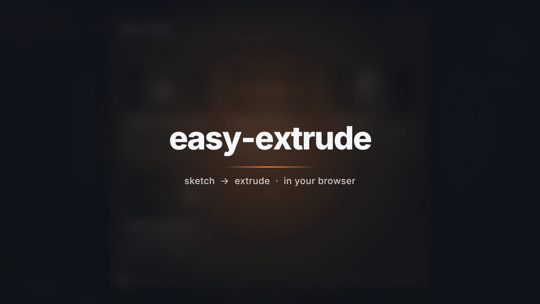

<div align="center">

# easy-extrude

**Sketch, extrude, and lay out a robot work cell — right in your browser.**

[](https://yuubae215.github.io/easy-extrude/)
[](LICENSE)



<sub>Recorded from the real app with <a href="tools/screencast/README.md"><code>pnpm screencast</code></a>.</sub>

</div>

---

## Getting Started

### 0 commands — just open it

**[yuubae215.github.io/easy-extrude →](https://yuubae215.github.io/easy-extrude/)**

Pick a template on the Home screen (or close it to start from a cube), then:

```
Shift+A → Sketch  ·  drag on the ground  ·  Enter  ·  drag up  ·  Enter
```

That's a solid. Works on desktop and mobile — nothing to install.

### 2 commands — run it locally

```bash
git clone https://github.com/yuubae215/easy-extrude.git && cd easy-extrude
pnpm install && pnpm dev     # → http://localhost:5173/easy-extrude/
```

Needs Node.js ≥ 20 and pnpm ≥ 10. No backend, no GPU drivers, no build step.

<details>
<summary><b>Want the full stack?</b> (scene persistence, STEP import, grasp search)</summary>

```bash
cd core && uv sync --extra dev --extra serve && cd ..   # once — needs uv
pnpm dev:stack                                          # core API + BFF + Vite
```

`pnpm dev:stub` tries the grasp-search screens with no backend at all (the live demo runs this way).

</details>

---

## What you can do

- **Model** — sketch → extrude, push faces (`E`), grab (`G`), duplicate, full undo/redo
- **Lay out a work cell** — start from process-layout templates; place zones, routes and frames; declare how things relate to each other
- **Ask a robot** — declare a part, a gripper and a camera, and the grasp-search backend answers where and how the robot can pick it — and *why not* when it can't, with a 3D replay
- **Generate scenes from a file** — a declarative Layout DSL with a CLI, a REST API and an optional natural-language front end ([ADR-045](docs/adr/ADR-045-external-layout-api.md))

Coordinates follow ROS ([REP-103](https://www.ros.org/reps/rep-0103.html)): +X forward, +Y left, +Z up, in millimetres.

---

## Learn more

| | |
|---|---|
| [`docs/ARCHITECTURE.md`](docs/ARCHITECTURE.md) | How it's built — frontend → contract → backend |
| [`docs/EVENTS.md`](docs/EVENTS.md) | All keyboard shortcuts and gestures |
| [`docs/adr/`](docs/adr/) | Why it's built that way (Architecture Decision Records) |
| [`core/README.md`](core/README.md) | The Python grasp-search engine |
| [`CLAUDE.md`](CLAUDE.md) | Rules to read before contributing |

## License

[MIT](LICENSE) — © yuubae215
