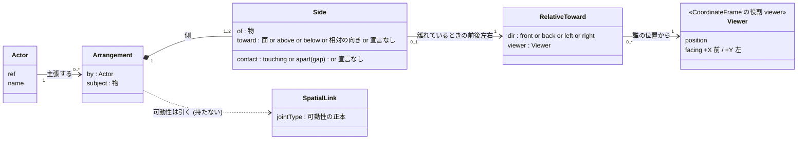
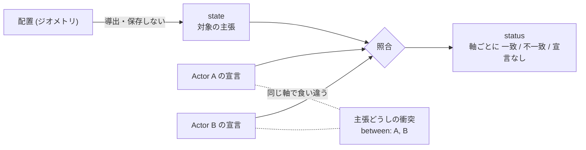

# 空間関係の概念モデル — 物どうしの関係を、誰が・どこから見て言うか

**この文書が正本であるもの:** 物どうしの関係 (`Arrangement`) を言う**語・実体・主張の持ち主**の
概念モデル。語彙は人によって・時とともに変わる (当事者 2026-10-21: 「語彙が主観で変化するだろう
から、データ構造か概念モデルで残しておいたほうが良い」) ので、決定の記録 (ADR) ではなくここで
育てる。

- **なぜそう決めたか**の正本は ADR-168 (ここには理由を書かない — §1.1)。
- **状態と基数**の正本は `docs/STATE_LEDGER.md` (§提案中の実体の「2 つの物の関係」「見る人」行)。
- スキーマ・コードが入ったら (ADR-168 S1)、**機械が読む正本はスキーマ**になり、この文書は
  スキーマから外れていないかを問う側になる (問い所は S1 で置く — 散文のまま放置しない、Q3)。

> 状態: **実装前** (ADR-168 Proposed)。下の型はまだコードに無い。

## 1. 実体と関係 (概念モデル)

読み方:

- **誰が言ったか** (`by` → `Actor`) と **どこから見てか** (`Viewer`) は別の線。1 人が自分の
  立ち位置から言えば同じ人を指すが、それは推論しない (ADR-168 D5)。
- `Arrangement` は可動性を持たない。subject と側の相手の間の `SpatialLink.jointType` から引く
  (運動学リンク 0 本 = 宣言なし / 1 本 = その値 / 2 本以上 = 矛盾)。

## 2. 主張の 3 欄 + 主張どうし

- status は**宣言 1 つと配置**の照合。主張どうしの衝突は**宣言どうし**の照合で、別の事実。
- どちらの衝突も、どちらが正しいかを決めない。連続量の「どれだけ外れたか」は `core/` の仕事
  (ADR-146 軸 1)。

## 3. 語の表 — 語 → 軸の値 → 実物のどこを指すか

原則 #33-4: どの語にも「走らせる前に、実物のどこを指すか確かめる手段」を一緒に置く。
確かめる手段の列が空の語は、まだ言えない語として扱う。

| 語 (正規形) | 軸 | 使える条件 | 基準 (参照枠) | 実物のどこを指すか (確かめる手段 — S1 で実装) |
|---|---|---|---|---|
| `touching` | 接触 | — | — | 接している面どうしを光らせる |
| `apart` (+gap mm) | 接触 | — | — | 2 つの間の最短の線分と隙間の数値 |
| `+x` `-x` `+y` `-y` `+z` `-z` | 向き | `touching` のとき | 内在 (相手の面 — ADR-152 の面語彙) | 相手の該当面を塗る (ADR-152 の「+x ってどこ？」と同じ確認) |
| `above` `below` | 向き | `apart` のとき | 絶対 (重力 = 世界 +Z) | 鉛直の補助線 |
| `front` `back` `left` `right` | 向き | `apart` のとき + `viewer` 必須 | 相対 (宣言された見る人) | 見る人の位置と正面の矢印、そこから見た左右の半空間 |
| 側 2 + 両方 `touching` | 3 者 | 2 側の向きが逆 | 各側の規則に従う | 両側の接触面 |
| 側 2 + 両方 `apart` | 3 者 | 2 側の向きが逆 | 各側の規則に従う | subject を通る軸と両側の隙間 |

**語は人によって変わる。** 人ごとの言い方 (「奥」「手前」「くっついてる」…) は、正規形の列へ
キュレーションした同義語の辞書 (`QUOTIENT_TABLE` — ADR-056) で落とす。辞書に行を足すのが正攻法の
拡張点で、embedding による近似の提案は `core/recommendation/` の propose-only レーンに置く
(ここには混ぜない)。

## 4. 退役する語

| 語 | 割った先 | 理由 (ADR-168 力学 1) |
|---|---|---|
| `above` (semanticType) | 接触 × 向き (`touching` + `+z`、または `apart` + `above`) | 定義は「離れて上方」、推論とテンプレは「載っている」で使っていた |
| `adjacent` (semanticType) | 接触 × 向き (`touching` + 側面) | 「接している」と「近い」が混ざり、どちら側かを捨てていた |

## 5. 変更の記録

語彙が変わったら (語を足す・割る・退役させる・同義語を足す) ここに 1 行足す。理由が
非自明なら ADR を起こし、ここからは名指しするだけにする。

| 日付 | 変更 | 出所 |
|---|---|---|
| 2026-10-21 | 初版。3 軸・3 欄・`Arrangement`・`viewer`・見る人と主張した人の分離 | ADR-168 (当事者との俯瞰) |
