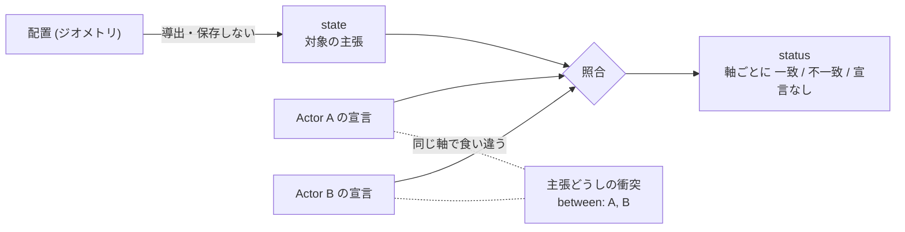

# 空間関係の概念モデル — 物どうしの関係を、誰が・どこから見て言うか

**この文書が正本であるもの:** 物どうしの関係 (`Arrangement`) を言う**語・実体・主張の持ち主**の
概念モデル。語彙は人によって・時とともに変わる (当事者 2026-10-21: 「語彙が主観で変化するだろう
から、データ構造か概念モデルで残しておいたほうが良い」) ので、決定の記録 (ADR) ではなくここで
育てる。

- **なぜそう決めたか**の正本は ADR-168 (ここには理由を書かない — §1.1)。
- **状態と基数**の正本は `docs/STATE_LEDGER.md` (「2 つの物の関係」「見る人」行)。
- **機械が読む正本**はスキーマ (`schema/context-0.7.schema.json` の `arrangement` /
  `arrangementSide`、`schema/layout-1.0.schema.json` の `frameRole`) と domain の語彙
  (`src/domain/arrangement.js` / `viewerFrame.js`)。この文書はそこから外れていないかを問われる側で、
  問い所は `src/SpatialRelationModelDoc.test.js` (§3 の語の表と domain の語彙を両向きに突き合わせる)。

> 状態: **S1・S1b 実装済み** (ADR-168 Accepted・段階実装 2026-10-22 / 2026-10-24)。型・スキーマ・state・status・
> 主張どうしの衝突はコードに在り、§3 の右端の列 (確かめる手段) は画面に出る — viewport の絵と N パネルの
> Relations 節。語 → 絵の機械の正本は `CONFIRMATION_BY_WORD` (`src/view/ArrangementStatusMath.js`)。

## 1. 実体と関係 (概念モデル)

読み方:

- **誰が言ったか** (`by` → `Actor`) と **どこから見てか** (`Viewer`) は別の線。1 人が自分の
  立ち位置から言えば同じ人を指すが、それは推論しない (ADR-168 D5)。
- `Arrangement` は可動性を持たない。subject と側の相手の間の `SpatialLink.jointType` から引く
  (運動学リンク 0 本 = 宣言なし / 1 本 = その値 / 2 本以上 = 矛盾)。

## 2. 主張の 3 欄 + 主張どうし

- status は**宣言 1 つと配置**の照合。主張どうしの衝突は**宣言どうし**の照合で、別の事実。
- どちらの衝突も、どちらが正しいかを決めない。連続量の「どれだけ外れたか」は `core/` の仕事
  (ADR-146 軸 1)。

## 3. 語の表 — 語 → 軸の値 → 実物のどこを指すか

原則 #33-4: どの語にも「走らせる前に、実物のどこを指すか確かめる手段」を一緒に置く。
確かめる手段の列が空の語は、まだ言えない語として扱う。

| 語 (正規形) | 軸 | 使える条件 | 基準 (参照枠) | 実物のどこを指すか (確かめる手段 — 画面の絵。機械側は `CONFIRMATION_BY_WORD`) |
|---|---|---|---|---|
| `touching` | 接触 | — | — | 接している面どうしを光らせる |
| `apart` | 接触 | — | — | 2 つの中心を結ぶ破線と隙間の数値 `≥ N mm` (観測の `gap` は分離の下界 — 隙間 mm の宣言は DEF-072) |
| `+x` `-x` `+y` `-y` `+z` `-z` | 向き | `touching` のとき = 接している面。`apart` のとき = その面より先の側 (「ロボットの +x 側に離して」— 2026-10-25) | 内在 (相手の面 — ADR-152 の面語彙。相手を回せば側も回る) | 相手の外箱の該当面を塗って名前を出す (ADR-152 の「+x ってどこ？」と同じ確認。離れているときは `+x side of …`)。実際に接している所は `touching` の矩形 (容器なら内側の床) |
| `above` `below` | 向き | `apart` のとき | 絶対 (重力 = 世界 +Z) | 鉛直の補助線 (相手の上面 → subject の下面、`below` は逆) |
| `front` `back` `left` `right` | 向き | `apart` のとき + `viewer` 必須 | 相対 (宣言された見る人) | 見る人の位置と正面の矢印、相手の中心を通る見る人の X・Y の 2 本の線 (前後・左右の境界) と 4 つの側の名前 |
| 側 2 + 両方 `touching` | 3 者 | 2 側の向きが逆 | 各側の規則に従う | 両側の接触面 |
| 側 2 + 両方 `apart` | 3 者 | 2 側の向きが逆 | 各側の規則に従う | subject を通る軸と両側の隙間 |

観測だけに在る値: 接触の `overlapping` (めり込み)。宣言の語ではないので、`touching` と宣言して
めり込んでいれば status は不一致になる。

**語は人によって変わる。** 人ごとの言い方 (「奥」「手前」「くっついてる」…) は、正規形の列へ
キュレーションした同義語の辞書 (`QUOTIENT_TABLE` — ADR-056) で落とす。辞書に行を足すのが正攻法の
拡張点で、embedding による近似の提案は `core/recommendation/` の propose-only レーンに置く
(ここには混ぜない)。**言い方の正本は辞書** — `QUOTIENT_TABLE` の分類 `spatial` (鍵 = 上の表の正規形)。
この分類は**分類内でだけ引ける** (`canonicalKeyIn(term, 'spatial')` — `CATEGORY_SCOPE`)。
`above` / `below` / `between` は比較演算子の同義語でもあるので、共有の引き方へ混ぜると演算子の
読みが黙って変わるため。ここには同義語を写さない (第二の源になる)。

**辞書に入れない語** — 理由は 2 種類ある (辞書はどちらも正規形に落とさず `null` を返す):

| 種類 | 語 | なぜ入れないか |
|---|---|---|
| **二択** (どちらの意味か決まらない) | 上・下 / 横・beside・next to / on / 前・後ろ・左手・右手・in front of・behind・left of・right of | 落とすと話し手の代わりに選ぶことになる。「上」= 離れて `above` か接して `+z` か。「横」= 接した側面か離れて横か。on = 接しているがどの面か。「ロボットの前」はたいていロボット自身の前 (内在) で、「私の前」は話し手の前 (相対) — 前後左右の正規形は**見る人**の語なので、話し手のものに決まる「手前」「奥」「向こう」だけを入れる |
| **組** (2 つの値が両方決まる) | 載っている = `touching` かつ `+z` | 何も選ばないが、辞書の鍵は 1 つの値しか持てない。組の言い方を受ける表は別に用意する (2026-10-25 計画) |

### まだ語が無いもの

- **物の正面。** 「機械の前に置く」の「前」は機械自身の正面だが、箱には決まった正面が無い (ロボットは
  REP-103 で +X)。いまは面の語 (`apart` + `+x` = +x 側) で言う。どの面が正面かを物に宣言できるように
  するかは未実装で、`docs/DEFERRAL_LEDGER.md` DEF-073 が持つ。

- **容器の中か外か。** ビンの内側の床に載るワークも、ビンの蓋の上に載る物も「`touching` + `+z`」
  になる (面の語は「触れた面から subject への向き」なので)。中か外かは別の事実で、まだ語が無い
  (既存の `contains` は領域の包含で、意味が違う)。

## 4. 退役する語

| 語 | 割った先 | 理由 (ADR-168 力学 1) |
|---|---|---|
| `above` (semanticType) | 接触 × 向き (`touching` + `+z`、または `apart` + `above`) | 定義は「離れて上方」、推論とテンプレは「載っている」で使っていた |
| `adjacent` (semanticType) | 接触 × 向き (`touching` + 側面) | 「接している」と「近い」が混ざり、どちら側かを捨てていた |

## 5. 変更の記録

語彙が変わったら (語を足す・割る・退役させる・同義語を足す) ここに 1 行足す。理由が
非自明なら ADR を起こし、ここからは名指しするだけにする。

| 日付 | 変更 | 出所 |
|---|---|---|
| 2026-10-21 | 初版。3 軸・3 欄・`Arrangement`・`viewer`・見る人と主張した人の分離 | ADR-168 (当事者との俯瞰) |
| 2026-10-22 | S1 実装。`apart` から隙間 mm の宣言を外した (DEF-072)、観測だけの値 `overlapping` を足した、同義語の衝突を記録した、「容器の中か外か」を語の無いものとして記録した | ADR-168 実装メモ (S1) |
| 2026-10-24 | **S1b**: §3 の右端の列を画面に出した (viewport の絵 + N パネルの Relations 節)。語 → 絵の表 `CONFIRMATION_BY_WORD` を domain の語彙と両向きに縛った。絵は中立で判定せず、status は印 (✓ / ✗ / –) で言い、色は不一致と衝突の印だけ (C4 — 当事者が実装前に決定) | ADR-168 実装メモ (S1b) |
| 2026-10-24 | **辞書を整備**: `QUOTIENT_TABLE` に分類 `spatial` (分類内でだけ引ける) を足し、14 の正規形に日英の言い方を置いた。2 つの事実を言う語 (上・下・横・載っている) は入れないと決めた。以後、語は辞書を先に整備してから設計・実装する (当事者) | ADR-168 実装メモ (辞書) |
| 2026-10-25 | **面の語を離れているときにも使える**ようにした (`apart` + 面 = その面より先の側。内在のまま — 相手を回せば側も回る)。辞書から内在と相対の二択の言い方 (前・後ろ・左手・右手・in front of・behind・left of・right of) を外し、`front`/`back` の英語表記を `nearer`/`farther` にした。入れない理由を「二択」と「組」に分けた。物の正面は DEF-073 | ADR-168 実装メモ (内在の側と二択 — 2026-10-25) |
