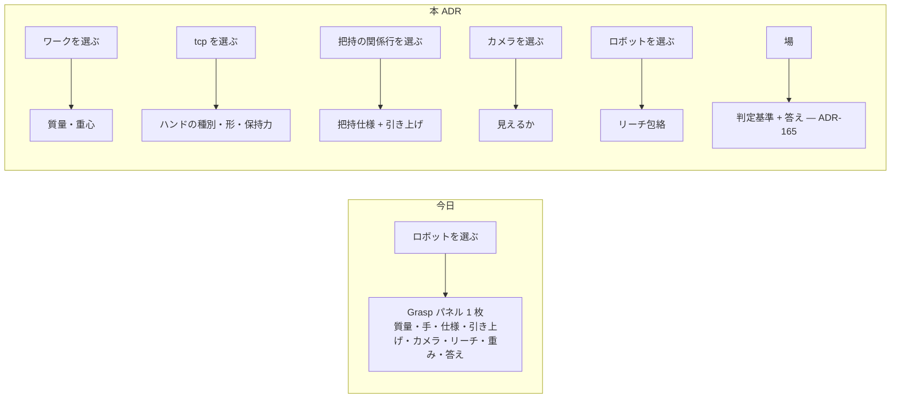

# 164. 宣言は、その事実を持つ実体の画面に住む — 把持まわりを 6 つのドメインへ配り直す

- Status: Proposed
- Date: 2026-10-11
- Deciders: yuubae215, Claude
- 段: IA 再設計 Phase 7 (`docs/ia-redesign/03-implementation-order.md`)
- Retires: GREP:src/components/Grasp/GraspSearchPanel.jsx::function\sMassEditor · GREP:src/components/Grasp/GraspSearchPanel.jsx::function\sHandEditor · PATH:src/components/RobotAppearanceToggle/RobotAppearanceToggle.jsx — 選択中のロボットのパネルに住んでいたワークとハンドの宣言欄と、実写 / 軽量の常設トグル。実装の PR で消える
- Supersedes / Superseded by: なし (Accepted にする PR で ADR-149 を `Partially superseded by ADR-164` にする — 常設トグルの部分だけ。実写を既定にする部分はそのまま)

## Context — Goal と力学 (§1.2 Goal)

### 要求

v8 のワイヤーフレーム (2026-08-02) の後、把持・ロボットの ADR が約 60 本入ったが、画面の
住所は一度も設計し直されていない。2026-10-10 に当事者と v9 → v10 の IA を回し、次の判断を得た
(記録の正本は `docs/ia-redesign/02-grouping-criteria.md` の「v9 段階2」以降、配置の正本は
`docs/ia-redesign/easy-extrude-wireframe-v10.html`)。

> Grasp 自体の仕様と、ハンドの仕様、ワークの仕様で本来のドメイン分けて整理したほうがいいと思う
> カメラと リーチはビジョンとアームドメインでしょう。探索そのものはユーザドメインだね
> 引き上げは把持のもの … 進入と引き上げの違いは、ワークを掴んでるか掴んでないか

**Goal:** *画面のある場所に出ている宣言は、その場所が指す実体の事実だけである。* どの宣言にも、
それを持つ実体があり、その実体を選べば宣言に届く。持ち主のいない宣言は無い。

### 力学 — 語彙はある。画面の線が無い

実機 (1440×900、Single-arm テンプレ) で `robot_base` を選び Grasp パネルを開くと、パネルは
高さ 1258px (表示 834px) で、次が 1 枚に並ぶ。

| 宣言 | 誰の事実か | データモデル上の住所 (今日) |
|---|---|---|
| 質量・重心 | ワーク | ワーク実体の欄 `mass` / `centerOfMass` |
| ハンドの種別・形・保持力 | ロボットの tcp | tcp 実体の `hand` / `hand.hold` |
| 把持仕様 (進入面・接触面・領域) | ワークとハンドの**関係** | ワーク実体の欄 `graspFeature.specs` |
| 引き上げ | 同上 (掴んだ後の動き) | ワーク実体の欄 `lift` |
| カメラ (見えるか) | カメラ | **住所なし** — パネルの React state (DEF-033) |
| リーチ包絡 | アーム | **住所なし** — 宣言の有無は React state、値は URDF 由来 (ADR-141) |
| 重み・topN | 探索を頼む人 | **住所なし** — React state (DEF-033) |

ワークとハンドの線はスキーマに既にある。画面だけが、それらを**選択中のロボット**の下に並べている
— 主語でない物の事実が主語の下にいる。語彙は在り、無いのは線だけ (原則 #33)。

### 力学 2 — 進入と引き上げは同じ把持の前後

当事者の根拠: 「進入と引き上げの違いは、ワークを掴んでいるかいないか。干渉のための条件が変わる」。
ADR-157 の言葉では、`close → lift` で携行物 (`held`) の基数が 0 → 1 になる。どちらも把持から
離して決まらない — `lift.along: reverseApproach` は「その候補の進入を逆に辿る」なので、把持
(進入) を参照しないと値が決まらない。ROS MoveIt も `moveit_msgs/Grasp` の中に
`pre_grasp_approach` と `post_grasp_retreat` を対で持つ。

### 力学 3 — 関係に行が無いと、片方が消えた関係は無言で落ちる

文書が宣言した把持の対象がシーンに無いとき、その宣言は今日**黙って落ちる** (DEF-035)。
宣言がワークの欄に住んでいる限り、ワークが無ければ宣言を見せる行も無い。関係そのものが行を
持てば、片方が消えた関係は**壊れた行**として残る (原則 #31 — 在るものを辿る表示は、無いものを出さない)。

## Options considered

- **A: 事実の持ち主ごとに 6 ドメインへ配る** (ワーク / ハンド / 把持 (関係) / ビジョン / アーム /
  ユーザ)。選んだ実体のパネルには、その実体が持つ宣言だけが出る — tradeoff: 1 回の探索の準備で
  複数の実体を選び直す。パネル間を ▸ リンクで渡す必要がある。
- **B: Grasp パネル 1 枚のまま、節を 6 つに分ける** — tradeoff: 見た目は整うが、ロボットを選ばないと
  ワークの質量に届かないままで、主語のずれ (DEF-033 の「どの実体に属するか」) は解けない。
- **C: 宣言を全部、場 (下部) の表へ出す** — tradeoff: 実体を選ばずに一覧できるが、3D で確かめる
  絵 (原則 #33 (4)) と宣言が離れる。場は「主張の食い違い」の器 (v8) で、事実の入力欄ではない。
- **D: 現状維持** — tradeoff: パネルは伸び続ける (今日 1.5 画面分)。

## Decision — Strategy (§1.2 Strategy) — 案 A

### D1 — パネルの中身は、選んだ実体が持ち主である宣言だけ

N Panel は選んだ実体の「実体」「位置・姿勢」に続けて、その実体の**宣言**の節を持つ。持ち主の
対応は次の表がちょうど全部 (6 行が母集団 — 表に無い宣言は作らない)。

| ドメイン | 持ち主 (選ぶもの) | 宣言 | 住所 |
|---|---|---|---|
| ワーク | 掴まれる物 | 質量・重心 | そのワークのパネル |
| ハンド | ロボットの tcp | 種別・形・保持力 | tcp のパネル |
| 把持 (関係) | ワーク × ハンド | 把持仕様・引き上げ | 関係の行のパネル (D2) |
| ビジョン | カメラ | 見えるか (画角・距離) | カメラのパネル (D3) |
| アーム | ロボット | リーチ包絡 (値は URDF、宣言の有無だけ人) | ロボットのパネル |
| ユーザ | 探索を頼む人 | 判定基準 (重み・上位) と答え | 場 (ADR-165) |

パネル間は ▸ リンクで渡る (把持 → ワーク / 手、ワーク → 把持 N 件)。未宣言の欄は「未宣言」と
言い、既定値で埋めない (ADR-120)。

### D2 — 把持は Outliner の意味側の「関係」の行

意味側に「関係」の節を足し、`把持: <ワーク> × <tcp>` を 1 行ずつ立てる。行を選ぶと 3D ではワークと
tcp が同時に光り、進入 (空手) と引き上げ (携行物あり) の 2 本の矢印が出る。片方の実体がシーンに
無い関係は **⚠ 壊れた行**として残り、付け替えの入口を持つ (DEF-035 の住所の候補 — 決着は実装の PR)。

### D3 — カメラを実体にする

カメラは幾何側に行を持つシーンの実体になり、選ぶと 3D に視錐台が出る。今日の
「📷 use current view」はカメラのパネルの「今の視点を写す」になる。DEF-033 の「カメラはシーンの
実体か探索セッションの属性か」は**シーンの実体**で決着する。

### D4 — 引き上げは把持仕様の中へ移す

`lift` はワーク (Solid) の欄から把持仕様 (`graspFeature.specs[]` の各仕様) の中へ移す。Layout DSL の
スキーマ変更 (`layout-1.0` → 版上げ) で、request 契約は open payload の側なので contractVersion は
上げない (CLAUDE.md §BFF と契約)。旧位置の `lift` は読み込み時に、そのワークの全仕様へ写して
告げる (黙って落とさない — 原則 #11)。

### D5 — 実写 / 軽量の常設トグルを撤去する

実写メッシュが読み込めないときだけ軽量表示へ自動で落ち、落ちたことをロボットのパネルが言う。
ADR-149 がトグルを置いた理由 (a) 読み込み失敗時の戻り道 は自動フォールバックと提示で足り、
(b) 帯域を節約したい人の選択 は常設の入口 1 個に見合わないと判断した (当事者判断)。
`window.__easyExtrude.setRobotAppearance` (e2e とデバッグの入口) は残す。

## Consequences — Evidence と tradeoff (§1.2 Evidence)

### 得られるもの

- どの宣言にも持ち主の実体があり、選べば届く。DEF-033 (カメラと重みの所属) が決着の形を得る。
- 把持パネルが「主語の隣の検査」(ADR-110) に戻り、宣言の一覧ではなくなる。
- 片方が消えた把持が壊れた行として見える (DEF-035)。

### 払うもの

- 1 回の探索の準備で、複数の実体を選び直す (リンクで渡るが、手数は増える)。
- カメラという実体の種が 1 つ増える (シーン JSON・Layout DSL・Outliner・3D の各所)。
- `lift` の移設は Layout DSL の版上げで、既存文書の読み替えが要る。
- 帯域を節約したい人は、実写を手で止める入口を失う。

### 検証 (証拠)

論証木: `docs/gsn/adr-164-a-declaration-lives-on-the-screen-of-the-entity-that-owns-the-fact.gsn`
(goal ごとの支えの正本。起票時点ですべて support-exploring、満期は機械可読)。

### 波及 (blast radius)

| 触るもの | 中身 |
|---|---|
| `src/components/NPanel/` | 実体ごとの宣言の節。ワーク / tcp / カメラ / ロボット / 関係 |
| `src/components/Grasp/GraspSearchPanel.jsx` | 宣言欄 (MassEditor / HandEditor ほか) を持ち主のパネルへ移し、検査だけに縮む |
| `src/components/Outliner/` | 意味側に「関係」の節と壊れた行 |
| `schema/layout-1.0.schema.json` | カメラの種、`lift` の移設 (版上げ) |
| `src/components/RobotAppearanceToggle/` | 撤去。ロボットのパネルにフォールバックの提示 |
| `docs/STATE_LEDGER.md` | §提案中の実体 にカメラの基数・把持の関係の基数の行 (本 ADR と同じコミット) |

**触らない:** response 契約 (`*-response.schema.json`)、`core/` の判定。

## Lens notes

- §1.1: 宣言の源は文書の 1 つのまま。画面の住所を持ち主に合わせるだけで、値の置き場は増やさない
  (カメラは新しい事実の置き場だが、今日は React state にあって源ですらなかった)。
- §1.4: 状態は増えないが**基数**が 2 つ動く — カメラ実体 `0..N` (0 が既定かつ正当: 見えるかを
  問わない探索)、把持の関係 `0..N` (うち壊れた関係 `0..N`)。`docs/STATE_LEDGER.md` §提案中の実体 に記録。
- 原則 #33: 新しい語は「関係」と「カメラ」の 2 つだけ。ほかは既にある語に線を引き直した。
- 原則 #31: 6 ドメインの表が母集団。検査は「表に無い宣言欄が画面に在る」個数を数える形にする。
