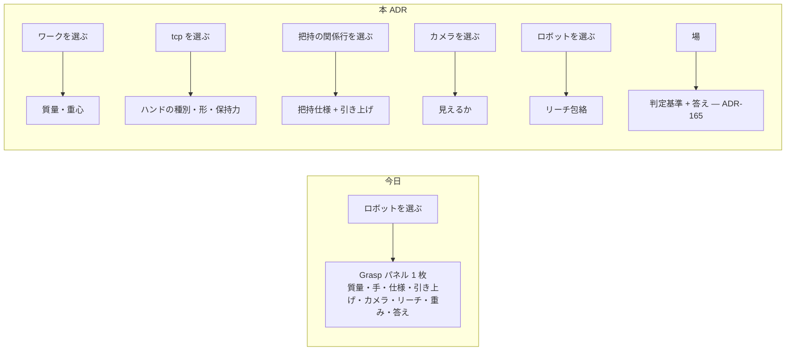

# 164. 宣言は、その事実を持つ実体の画面に住む — 把持まわりを 6 つのドメインへ配り直す

- Status: Accepted (2026-10-11 — 当事者が俯瞰で合意。段階実装: D1・D5 (PR1)、D2 (PR2) 実装済み、D4 → D3 は続く PR — `docs/ia-redesign/03-implementation-order.md` Phase 7)
- Date: 2026-10-11
- Deciders: yuubae215, Claude
- 段: IA 再設計 Phase 7 (`docs/ia-redesign/03-implementation-order.md`)
- Retires: GREP:src/components/Grasp/GraspSearchPanel.jsx::function\sMassEditor · GREP:src/components/Grasp/GraspSearchPanel.jsx::function\sHandEditor · PATH:src/components/RobotAppearanceToggle/RobotAppearanceToggle.jsx — 選択中のロボットのパネルに住んでいたワークとハンドの宣言欄と、実写 / 軽量の常設トグル。実装の PR で消える
- Supersedes / Superseded by: ADR-149 を部分的に supersede (常設トグルの部分だけ — トグルを撤去した PR1 で `Partially superseded by ADR-164` にした。実写を既定にする部分はそのまま)

## Context — Goal と力学 (§1.2 Goal)

### 要求

v8 のワイヤーフレーム (2026-08-02) の後、把持・ロボットの ADR が約 60 本入ったが、画面の
住所は一度も設計し直されていない。2026-10-10 に当事者と v9 → v10 の IA を回し、次の判断を得た
(記録の正本は `docs/ia-redesign/02-grouping-criteria.md` の「v9 段階2」以降、配置の正本は
`docs/ia-redesign/easy-extrude-wireframe-v10.html`)。

> Grasp 自体の仕様と、ハンドの仕様、ワークの仕様で本来のドメイン分けて整理したほうがいいと思う
> カメラと リーチはビジョンとアームドメインでしょう。探索そのものはユーザドメインだね
> 引き上げは把持のもの … 進入と引き上げの違いは、ワークを掴んでるか掴んでないか

**Goal:** *画面のある場所に出ている宣言は、その場所が指す実体の事実だけである。* どの宣言にも、
それを持つ実体があり、その実体を選べば宣言に届く。持ち主のいない宣言は無い。

### 力学 — 語彙はある。画面の線が無い

実機 (1440×900、Single-arm テンプレ) で `robot_base` を選び Grasp パネルを開くと、パネルは
高さ 1258px (表示 834px) で、次が 1 枚に並ぶ。

| 宣言 | 誰の事実か | データモデル上の住所 (今日) |
|---|---|---|
| 質量・重心 | ワーク | ワーク実体の欄 `mass` / `centerOfMass` |
| ハンドの種別・形・保持力 | ロボットの tcp | tcp 実体の `hand` / `hand.hold` |
| 把持仕様 (進入面・接触面・領域) | ワークとハンドの**関係** | ワーク実体の欄 `graspFeature.specs` |
| 引き上げ | 同上 (掴んだ後の動き) | ワーク実体の欄 `lift` |
| カメラ (見えるか) | カメラ | **住所なし** — パネルの React state (DEF-033) |
| リーチ包絡 | アーム | **住所なし** — 宣言の有無は React state、値は URDF 由来 (ADR-141) |
| 重み・topN | 探索を頼む人 | **住所なし** — React state (DEF-033) |

ワークとハンドの線はスキーマに既にある。画面だけが、それらを**選択中のロボット**の下に並べている
— 主語でない物の事実が主語の下にいる。語彙は在り、無いのは線だけ (原則 #33)。

### 力学 2 — 進入と引き上げは同じ把持の前後

当事者の根拠: 「進入と引き上げの違いは、ワークを掴んでいるかいないか。干渉のための条件が変わる」。
ADR-157 の言葉では、`close → lift` で携行物 (`held`) の基数が 0 → 1 になる。どちらも把持から
離して決まらない — `lift.along: reverseApproach` は「その候補の進入を逆に辿る」なので、把持
(進入) を参照しないと値が決まらない。ROS MoveIt も `moveit_msgs/Grasp` の中に
`pre_grasp_approach` と `post_grasp_retreat` を対で持つ。

### 力学 3 — 関係に行が無いと、片方が消えた関係は無言で落ちる

文書が宣言した把持の対象がシーンに無いとき、その宣言は今日**黙って落ちる** (DEF-035)。
宣言がワークの欄に住んでいる限り、ワークが無ければ宣言を見せる行も無い。関係そのものが行を
持てば、片方が消えた関係は**壊れた行**として残る (原則 #31 — 在るものを辿る表示は、無いものを出さない)。

## Options considered

- **A: 事実の持ち主ごとに 6 ドメインへ配る** (ワーク / ハンド / 把持 (関係) / ビジョン / アーム /
  ユーザ)。選んだ実体のパネルには、その実体が持つ宣言だけが出る — tradeoff: 1 回の探索の準備で
  複数の実体を選び直す。パネル間を ▸ リンクで渡す必要がある。
- **B: Grasp パネル 1 枚のまま、節を 6 つに分ける** — tradeoff: 見た目は整うが、ロボットを選ばないと
  ワークの質量に届かないままで、主語のずれ (DEF-033 の「どの実体に属するか」) は解けない。
- **C: 宣言を全部、場 (下部) の表へ出す** — tradeoff: 実体を選ばずに一覧できるが、3D で確かめる
  絵 (原則 #33 (4)) と宣言が離れる。場は「主張の食い違い」の器 (v8) で、事実の入力欄ではない。
- **D: 現状維持** — tradeoff: パネルは伸び続ける (今日 1.5 画面分)。

## Decision — Strategy (§1.2 Strategy) — 案 A

### D1 — パネルの中身は、選んだ実体が持ち主である宣言だけ

N Panel は選んだ実体の「実体」「位置・姿勢」に続けて、その実体の**宣言**の節を持つ。持ち主の
対応は次の表がちょうど全部 (6 行が母集団 — 表に無い宣言は作らない)。

| ドメイン | 持ち主 (選ぶもの) | 宣言 | 住所 |
|---|---|---|---|
| ワーク | 掴まれる物 | 質量・重心 | そのワークのパネル |
| ハンド | ロボットの tcp | 種別・形・保持力 | tcp のパネル |
| 把持 (関係) | ワーク × ハンド | 把持仕様・引き上げ | 関係の行のパネル (D2) |
| ビジョン | カメラ | 見えるか (画角・距離) | カメラのパネル (D3) |
| アーム | ロボット | リーチ包絡 (値は URDF、宣言の有無だけ人) | ロボットのパネル |
| ユーザ | 探索を頼む人 | 判定基準 (重み・上位) と答え | 場 (ADR-165) |

パネル間は ▸ リンクで渡る (把持 → ワーク / 手、ワーク → 把持 N 件)。未宣言の欄は「未宣言」と
言い、既定値で埋めない (ADR-120)。

### D2 — 把持は Outliner の意味側の「関係」の行

意味側に「関係」の節を足し、`把持: <ワーク> × <tcp>` を 1 行ずつ立てる。行を選ぶと 3D ではワークと
tcp が同時に光り、進入 (空手) と引き上げ (携行物あり) の 2 本の矢印が出る。片方の実体がシーンに
無い関係は **⚠ 壊れた行**として残り、付け替えの入口を持つ (DEF-035 の住所の候補 — 決着は実装の PR)。

### D3 — カメラを実体にする

カメラは幾何側に行を持つシーンの実体になり、選ぶと 3D に視錐台が出る。今日の
「📷 use current view」はカメラのパネルの「今の視点を写す」になる。DEF-033 の「カメラはシーンの
実体か探索セッションの属性か」は**シーンの実体**で決着する。

### D4 — 引き上げは把持仕様の中へ移す

`lift` はワーク (Solid) の欄から把持仕様 (`graspFeature.specs[]` の各仕様) の中へ移す。Layout DSL の
スキーマ変更 (`layout-1.0` → 版上げ) で、request 契約は open payload の側なので contractVersion は
上げない (CLAUDE.md §BFF と契約)。旧位置の `lift` は読み込み時に、そのワークの全仕様へ写して
告げる (黙って落とさない — 原則 #11)。

### D5 — 実写 / 軽量の常設トグルを撤去する

実写メッシュが読み込めないときだけ軽量表示へ自動で落ち、落ちたことをロボットのパネルが言う。
ADR-149 がトグルを置いた理由 (a) 読み込み失敗時の戻り道 は自動フォールバックと提示で足り、
(b) 帯域を節約したい人の選択 は常設の入口 1 個に見合わないと判断した (当事者判断)。
`window.__easyExtrude.setRobotAppearance` (e2e とデバッグの入口) は残す。

## Consequences — Evidence と tradeoff (§1.2 Evidence)

### 得られるもの

- どの宣言にも持ち主の実体があり、選べば届く。DEF-033 (カメラと重みの所属) が決着の形を得る。
- 把持パネルが「主語の隣の検査」(ADR-110) に戻り、宣言の一覧ではなくなる。
- 片方が消えた把持が壊れた行として見える (DEF-035)。

### 払うもの

- 1 回の探索の準備で、複数の実体を選び直す (リンクで渡るが、手数は増える)。
- カメラという実体の種が 1 つ増える (シーン JSON・Layout DSL・Outliner・3D の各所)。
- `lift` の移設は Layout DSL の版上げで、既存文書の読み替えが要る。
- 帯域を節約したい人は、実写を手で止める入口を失う。

### 検証 (証拠)

論証木: `docs/gsn/adr-164-a-declaration-lives-on-the-screen-of-the-entity-that-owns-the-fact.gsn`
(goal ごとの支えの正本。起票時点ですべて support-exploring、満期は機械可読)。

### 波及 (blast radius)

| 触るもの | 中身 |
|---|---|
| `src/components/NPanel/` | 実体ごとの宣言の節。ワーク / tcp / カメラ / ロボット / 関係 |
| `src/components/Grasp/GraspSearchPanel.jsx` | 宣言欄 (MassEditor / HandEditor ほか) を持ち主のパネルへ移し、検査だけに縮む |
| `src/components/Outliner/` | 意味側に「関係」の節と壊れた行 |
| `schema/layout-1.0.schema.json` | カメラの種、`lift` の移設 (版上げ) |
| `src/components/RobotAppearanceToggle/` | 撤去。ロボットのパネルにフォールバックの提示 |
| `docs/STATE_LEDGER.md` | §提案中の実体 にカメラの基数・把持の関係の基数の行 (本 ADR と同じコミット) |

**触らない:** response 契約 (`*-response.schema.json`)、`core/` の判定。

## 俯瞰で決まったこと (2026-10-11、実装の前に当事者と)

実装の前の一拍俯瞰 (`/whiteboard`) で、本文のままでは言えない文が 2 つ見つかり、当事者が決めた。

- **D4 の住所の改訂 — 引き上げは把持仕様の 1 つ 1 つではなく、把持の関係 (ワーク × ハンド) に 1 個。**
  本文の「`graspFeature.specs[]` の各仕様の中へ」のままだと、(a) 今日正当な「仕様 0 個 + 引き上げ宣言あり」
  (候補は `surfaceSamples` から作る) が言えなくなる — 基数 0 の住所が消える (原則 #31)。(b) 仕様ごとに違う
  引き上げはワイヤに載らない — request の `target.lift` は 1 個で、`graspSpec` は閉じている
  (`additionalProperties:false`)。関係に 1 個なら仕様 0 個でも住所があり、ワイヤは今の `target.lift` のまま。
  進入と引き上げが「同じ把持の前後」であること (力学 2) はそのまま保たれる — 関係が把持である。
- **D3 の基数 N — 探索に載るカメラはロボットと同じ picker で指す。** ワイヤの `camera` は 1 個なので、
  シーンにカメラが N 台あるとき「どれのことか」の語が要る。1 台なら暗黙、N 台なら選ぶまで Run の gap、
  0 台は見えるかを問わない (ADR-090 の robot picker と同じ形)。
- **D2 の同一性 — 把持の関係は、どの tcp との関係かを文書が宣言する (2026-10-11、PR1 の後に当事者が決定 — 案 B)。**
  今日の文書は把持の宣言 (`graspFeature`) をワークにだけ持ち、どのハンドとの関係かを言わない。ロボットが
  N 台だと関係の行「<ワーク> × <tcp>」の右辺が決まらない (語彙の欠け — 原則 #33 (1): 1 つの宣言が
  「どこを掴むか」と「どの手で」を暗黙に兼ねている)。却下した案 A (右辺は探索の主語の tcp) は
  スキーマを変えないが、行が「今選んでいる 1 本の手」の写しになり、主語を替えると関係が別物に化ける。
  採った案 B: 把持の宣言がその tcp を ref で名指す欄を持つ (Layout DSL のスキーマ変更 — D4 の版上げと
  同じ PR か直前で行う)。これで関係の行は保存された事実の導出になり、片方 (ワーク / tcp) がシーンに
  無い関係は**壊れた行**として数えられる (DEF-035)。旧文書 (欄なし) の読み替えと、tcp が 1 本だけの
  ときの扱いは PR2 の俯瞰で決める。
- **PR2 の俯瞰 (2026-10-11、当事者が推奨どおり合意)** — D2 を実装する前に、言えない文が 5 つ見つかった。
  1. **旧文書と tcp 1 本のとき — 読み込み時に書かない。** 欄の無い宣言は関係の状態 `hand-undeclared` で、
     行は「× hand not declared」と言う。tcp が 1 本でも既定で埋めない (Yellow Card「必須入力の欠落に既定値を
     与えない」)。関係のパネルが「name <tcp>」を 1 押下で出し、押すことが宣言になる。却下: 1 本なら読み込み時に
     写して告げる (D4 の `lift` の扱いと同じ形だが、`lift` は*位置*の移設で事実は変わらない。手の名指しは
     *事実の新設*で、写すと誰も言っていない事実が文書に入る)。
  2. **宣言した手 ≠ 探索の主語の手 — Run の gap。** 手を黙って取り替えない (原則 #11)。`hand-undeclared` は
     gap ではない (主語で解く — 旧文書すべてがそう動いていた)。関係の行を選ぶと、名指された手のロボットが
     主語になる (入口が主語を書く — ADR-130 D2 の先例) ので、選んだ関係そのもので gap は踏まない。
  3. **ワークごとに関係 `0..1`。** `graspFeature` が Solid に 0..1 なので、1 つのワークを 2 本の手で掴み分ける
     語はまだ無い。ワイヤは 1 回の探索で手 1 本なので、上限を**宣言して**台帳に書いた。
  4. **壊れた行の付け替えは tcp 側だけ。** ワーク側 (改名への追従) は DEF-035 に残した — 壊れたワークの行の
     出口は今日は「この宣言を消す」(undo 可) だけ。
  5. **欄の名前は `tcp`。** `graspSpec.hand` が既に*手の種別*を指すので、`hand` だと 1 語が 2 事実を運ぶ
     (原則 #33 (1))。`tcp` は `robotRole: tcp` と同じ語で、指す先は実体である。

## 実装の記録

### PR1 — D1 (ワーク・ハンド・アーム) と D5 (2026-10-11)

- **住所の表**: `src/view/DeclarationOwnership.js` の `DECLARATION_OWNERS` (6 行 = 母集団)。編集欄は
  `data-declaration="<key>"` を持ち、`src/components/NPanel/DeclarationOwnership.test.js` が「持ち主の
  無い欄 / 住所違いの欄 / 欄の無い宣言」をそれぞれ 0 個と数える。まだ持ち主が画面に居ない 3 行
  (把持 — D2、ビジョン — D3、ユーザ — ADR-165) は `movesWith` で名指しし、集合を ratchet で固定した。
- **持ち主のパネル**: ワーク = `NPanel/declarations/WorkDeclarations.jsx` (質量・重心)、tcp =
  `HandDeclarations.jsx` (種別・形・保持力)、ロボット = `ArmDeclarations.jsx` (リーチ包絡と描画の提示)。
  Grasp パネルは宣言欄を失い、`OwnerDeclarationLinks` が状態を読んで ▸ で持ち主へ渡す (ADR-110 の
  「主語の隣の検査」へ戻った)。共有の入力部品は `Grasp/GraspFields.jsx` へ切り出した (複製しない)。
- **読み口**: `GraspController.workDeclarationsOf(sceneId)` / `handDeclarationsOf(frameId)` — 探索と同じ
  1 回のシーン解決 (`_searchLayout`、ADR-163 の `refOf` を通す) から読む。**tcp は選んだ tcp のロボット**
  を答える — 旧 Grasped カードは探索の主語のハンドを編集しており、ロボット B の tcp を選んでも A の
  ハンドが出た。
- **本文から動いた点 1 — リーチ包絡はロボットごと。** 本文は「アーム = ロボットのパネル」としか言って
  いないが、包絡を store の 1 スロットにすると N 台のロボットが 1 つの宣言を共有し「どれのことか」が
  言えない。`context.reachDeclarations[robotId]` とし、Run は探索の主語の行を読む。文書の住所はまだ無い
  (React state → store へ移っただけ。DEF-033 と同じ問い)。
- **本文から動いた点 2 — 表に出た既存欠陥: doc edit の再投影が選択を落としていた。** 宣言を Grasp
  パネルで編集していた間は、そのパネルの投影を setter 自身の promise が読み直していたので見えなかった。
  ワークのパネルへ移すと、質量を宣言した瞬間に active 実体が落ち、パネルが編集前の「not declared」を
  出し続けた。`ContextService` が clear の前に `projectionReplacing` を出し、`AppController` が
  `contextChanged` で選び直す — 同一性は id、なければ layout ref (`selectionAfterProjection`)。
  CODE_CONTRACTS「A Re-projection Restores the Selection by Identity」/ PHILOSOPHY Yellow Card。
- **D5**: `RobotAppearanceToggle` を削除。自動フォールバック (`adoptFailed`) は既に在ったので、足したのは
  **落ちたことを言い続ける欄** (`uiStore.robotMeshFallbacks`、ロボットのパネルが読む) だけ。トグルが
  兼ねていた ADR-150 D2 の LOADING… は、読み込み中だけ在る表示 `RobotMeshLoadingNotice` に残した
  (操作ではないので固定スロットは要らない)。

### PR2 — D2: 把持は関係の行 (2026-10-11)

- **語と欄**: `graspFeature.tcp` (layout-1.0 と context-0.5 の双子に同時に — ADR-117 の教訓)。request 契約は
  変えない (ワイヤは今の `target` のまま)。読むのは `resolveGraspFeature` だけ (解決済みの `.tcp` を全状態に
  運び、仕様の書き直し `featureToDsl` でも落ちない)、書くのは `setEntityGraspTcp` だけ —
  `IDENTITY_RULES` に「把持の関係の右辺」として登録した。
- **導出**: `src/domain/graspRelation.js` の `graspRelationsOf({docDsl, sceneDsl})`。母集団は**文書の宣言**で、
  4 状態 (`ok` / `hand-undeclared` / `broken-object` / `broken-tcp`) は保存せず毎回導出する — 状態機械ではなく
  導出の全域表を `STATE_TRANSITIONS` §把持の関係 に起こした。GraspController が `context.graspRelations` へ
  投影し (唯一の書き手)、再導出は `contextChanged` と実体の増減 (マイクロタスクで 1 回に畳む)。
- **選択の第 3 の種** `relations` (ADR-107 の union を広げた。入口の 5 verb は増えず、`SelectionOwnership` の
  census は作り直さずに通った)。member は `relationRef(objectRef)` — 同じ ref のワーク実体とは比較不能。
  3D の姿は `relationPair` (ワークと名指された tcp を同時に outline、文脈は DIMMED)、N パネルの body は
  `relation`、ナビゲータの住所は意味側。宣言の確認の絵の表 (`CONFIRMATION_BY_FIELD`) にも
  `graspFeature.tcp → selection/relationPair` を足した (語 → 絵、原則 #33 (4))。
- **画面**: Outliner の意味側 (Document) に「Grasp relations (N, k broken)」の節。壊れた行は ⚠ と caution 色で
  残る。関係のパネル (`NPanel/declarations/GraspDeclarations.jsx`) に 手の名指し・付け替え / ▸ ワーク / ▸ tcp /
  把持仕様の編集 (`GraspSpecEditor` を Grasp パネルから**そのまま**移した) / 引き上げの表示。
  `DECLARATION_OWNERS` の grasp 行は `relation-panel` へ移り、`movesWith` の ratchet は 3 → 2。
  Grasp パネルは「how to grasp: … ▸ grasp: <ワーク> × <手>」の検査の行だけを持つ。ワークのパネルにも ▸ を置いた。
- **本文から動いた点 — まだ宣言の無い物にも入口が要った。** 編集欄を関係のパネルへ移すと、関係は宣言からの
  導出なので「最初の宣言」を始める場所が無くなる (鶏と卵)。関係の選択は、宣言が無い掴める物についても
  許し (パネルは「no grasp declared on this object yet」と言い、Outliner には行を立てない — 宣言が在るものだけが
  行)、最初の宣言でそのまま関係になる。
- **本文から動いた点 — DEF-035 は半分。** 把持の孤児は行を得たが、把持宣言を持たないワークに付いた質量・重心の
  孤児は関係が無いので今日も黙って落ちる。DEF-035 の満期を住所ごと付け替えて残した。
- **証拠**: `graspRelation.test.js` (9) / `GraspController.test.js` (+4: 別の手の把持で Run が止まる・パネルと同じ
  gap・対の scene id・壊れた tcp) / `selection.test.js` (+1) / `DocBuilder.test.js` (+4) / `graspFeature.test.js` (+3) /
  `e2e/grasp-stub.spec.js` S17 (宣言 → 行 → 名指し → ワーク削除で ⚠ → undo)。既存の S10 / S15 / S16 は編集欄の
  移動に合わせて入口を名指しに直した (`owner-link-grasp` / `owner-link-mass`)。

## Lens notes

- §1.1: 宣言の源は文書の 1 つのまま。画面の住所を持ち主に合わせるだけで、値の置き場は増やさない
  (カメラは新しい事実の置き場だが、今日は React state にあって源ですらなかった)。
- §1.4: 状態は増えないが**基数**が 2 つ動く — カメラ実体 `0..N` (0 が既定かつ正当: 見えるかを
  問わない探索)、把持の関係 `0..N` (うち壊れた関係 `0..N`)。`docs/STATE_LEDGER.md` §提案中の実体 に記録。
- 原則 #33: 新しい語は「関係」と「カメラ」の 2 つだけ。ほかは既にある語に線を引き直した。
- 原則 #31: 6 ドメインの表が母集団。検査は「表に無い宣言欄が画面に在る」個数を数える形にする。
