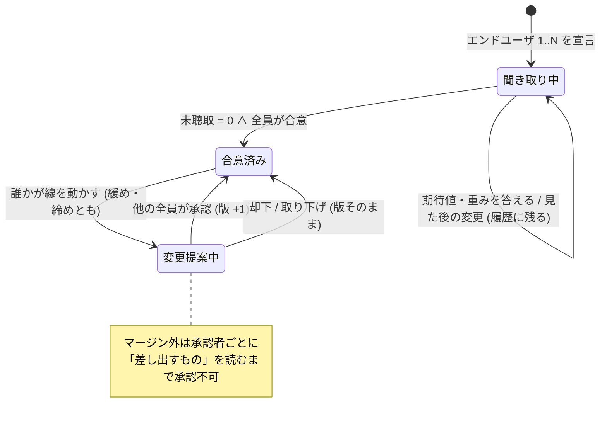

# 165. 判定基準は設計の前に聞き切る — 期待値と重みで聞き、合意した線は提案でしか動かない

- Status: Proposed
- Date: 2026-10-11
- Deciders: yuubae215, Claude
- 段: IA 再設計 Phase 8 (`docs/ia-redesign/03-implementation-order.md`)
- Retires: GREP:src/context/ContextDslSchema.js::'maintainer',\s'endUser' — 職能 (`maintainer`) と立場 (`endUser`) を同じ列挙に入れた `VALID_ROLES`。実装の PR で 2 つの欄に割れて消える
- Supersedes / Superseded by: なし (ADR-063 選択優先インテークと ADR-104 所有権・提案・証憑の上に積む)

## Context — Goal と力学 (§1.2 Goal)

### 要求 (当事者、2026-10-10〜11)

> このアプリの重要な使命は、設計する前にエンドユーザにすべての重みを聞き切ることです。
> 語彙の充足やイラストでイメージをつけてもらうことや、コスト関数的に重みでクライテリアを
> 表現できる、などいわばゲームのキャラメイク的にやってみてどうなりそうか見せてユーザに
> 選択させる

続く対話で決まったこと (記録の正本は `docs/ia-redesign/02-grouping-criteria.md`、フローの正本は
`docs/ia-redesign/criteria-charamake-flow-v4.html`):

1. エンドユーザは**立場**であって職能ではない。立つ人は保全・決裁者・生産技術・製造技術・環境安全・
   SIer など、1 人とは限らない。
2. 聞く語は **QCD + S**。現場で最初に言われるのはタクト、次に位置精度、言われないが効いているのが安全。
   重要な要素から言葉に分解する。C は設備費と保全性。
3. どの要素も**しきい値と重みの同じ形** (安全も — 人と当たらないにも、どれだけマージンを取るかがある)。
4. **しきい値 = クライテリア = 期待値**。期待値と実態の差で人の感情が変わる。
5. 結果を見て期待値が動くのはよい。ただし**履歴は残す** — 「安全はあのとき削りましたよね?」と
   言えるように。それは教育ではなく**誘導**。
6. 線の変更はゼロサムで誰かのリソースを使うので、**最初に合意した線からの変更は他のエンドユーザの
   承認が要る** (緩めるのも締めるのも)。
7. 承認の**重さは同じ**。マージン外なら**差し出すものを読ませる**。**みんなの関心のインジケータ**を出す。
8. インジケータの値を出す**コスト関数はアイデア** (core/)。隠した式の数字で合意してよい —
   **式と重みは、そのインジケータを持つ人が保証する**。

**Goal:** *設計が始まる時点で、すべてのエンドユーザの、すべての要素の期待値と重みが文書にあり、
全員が合意している。合意の後に線が動いたなら、誰が・何を見て・誰の承認で動かしたかが残っている。*

### 力学 1 — 聞かれなかった要素は行を持たない

現場で安全は「言われない」。発言を拾って行を作る聞き方では、安全の行は永久に生まれない
(原則 #31)。必要な要素を列挙し、全員 × 全要素の**空欄の個数**を数え、0 になるまで設計へ進めない。

$$
\text{未聴取} = \sum_{u \in U_{\text{end}}} \Big( |\{c \in \{D,Q,C,S\} : \text{比重 未回答}\}| + |\{e \in E : \text{期待値・重み 未回答}\}| \Big),\quad \text{設計へ} \iff \text{未聴取} = 0 \land \text{合意済み}
$$

### 力学 2 — 数値は答えられないが、結果は選べる

十数個の重みをいきなり数値で答えられる人はいない。価値木 (AHP と同じ階層) の上の段 (QCDS の比重) は
型から選んで直し、下の段は期待値と重みを図つきで聞き、最後に**案を並べて選ばせる** (選好の聞き出し —
コンジョイント分析と同じ考え方)。案の実態値と、案の選択から重みを推し量る計算は core/ の仕事。

### 力学 3 — 線はゼロサム

合意した線のどれかを動かすと、マージンが十分にあるとき以外は別の要素 = 別の誰かの線から取っている。
だから線は**合意の対象**で、動かす行為は ADR-104 の**提案**と同じ形になる。

## Options considered

- **A: 設計の前に、キャラメイク型のフローで全エンドユーザから聞き切り、合意した線を提案でだけ動かす** —
  tradeoff: 設計に入るまでの手数が増える。エンドユーザ全員の時間が要る。
- **B: 重みは設計しながら必要になったときに聞く** (今日の形 — Grasp パネルの React state) —
  tradeoff: 聞かれなかった要素 (安全) は永久に聞かれず、後から依存が見つかってループが増える (L_hidden)。
- **C: 聞き切るが、合意後の変更は本人だけで通す** — tradeoff: ゼロサムの相手が知らないうちに線が
  下がる。履歴は残っても、合意ではなくなる。
- **D: 関心の値を front で重みから計算して見せる** — tradeoff: 計算式はアイデアなので、front に
  置けば第二のコスト関数になる (CLAUDE.md §AI 向けガード 軸 1)。

## Decision — Strategy (§1.2 Strategy) — 案 A

### D1 — 職能と立場を分ける

actor は「誰か」(職能: 保全 / 生産技術 / 製造技術 / 環境安全 / 決裁者 / SIer …) と、「このプロジェクトで
エンドユーザの立場に立つか」を**別の欄**で持つ。`VALID_ROLES` が 2 種類の事実を 1 つの列挙に
入れていた形を割る (原則 #33 (1))。エンドユーザの基数は `1..N` で、0 人では聞き取りが始まらない。
Context DSL の版上げ (`context/0.6`)。

### D2 — 価値木は QCD + S、どの要素も期待値と重みの同じ形

上の段は D 速さ / Q 品質 / C コスト / S 安全 の比重。下の段の要素 (起票時の案):
D = タクト、Q = 位置精度・落とさない (保持の余裕)、C = 設備費・保全性、
S = 人と当たらない (マージン)・止めたら止まる (停止距離)。どの要素も
`{期待値 (= クライテリア), 重み (期待を超えた分の嬉しさ)}` を持つ。期待値は Context DSL の受け入れ判定の
しきい値 (L5、許容領域)、重みは目的の重みに乗る — 新しい層は作らない。
「落とさない」「止めたら止まる」は Claude が置いた案で、当事者の確認を待つ。

### D3 — 聞き取りはキャラメイク型のフロー

誰に → 比重 (型から) → 期待値と重み (図つき) → やってみる (案を並べ、期待値との差を ☺ ○ ☹ で見せる)
→ 聞き切ったか。期待値と実態の差は閉形式なので front で出してよく (軸 3)、顔と色は演出として
クライアントで導出し契約に足さない (原則 #29)。**総合点は出さない** — 重みの組み合わせ方は core/ の
スコア関数。ADR-063 の FSM (`context.wizard`) の上に載せる。

### D4 — 見た後の変更は履歴に残す (誘導の記録)

初めて「やってみる」を開いた瞬間の期待値を写し取り、以後の変更を追記のみで残す。各変更は
誰が・何を・**どの案を見た後に**を持つ。1 回の「やってみる」ごとに締めた / 緩めた要素を組にし、
「タクトを取るために人と当たらないを緩めた」の 1 文で残す。安全を緩めた組には「安全を削った」が付く。

### D5 — 合意と、合意後の変更提案

全エンドユーザが「合意する」を押すと線は **合意済み v1**。以後の線の変更は ADR-104 の**提案**
(`提案 → 承認 / 却下`) になり、**他のエンドユーザ全員**の承認で版が上がる (v2, v3 …)。承認の重さは
マージンの内外で変えない。マージン外の提案は**差し出すもの**を承認者ごとに読むまで承認を押せない。
エンドユーザが 1 人なら承認者がいないので、変更はそのまま通り「承認者なし — 記録のみ」と残る
(v8 の単独決定と同じ扱い)。

禁止遷移: `聞き取り中 → 変更提案中` (合意前に提案は無い)、`変更提案中 → 合意済み` を承認者の欠けた
まま通すこと、合意済みの線を提案を経ずに書き換えること。状態の正本は `docs/STATE_TRANSITIONS.md`
§判定基準の線 (本 ADR と同じコミットで節を起こす)。

### D6 — 関心インジケータと差し出すものは core/ が返し、持ち主が保証する

エンドユーザごと × 大項目の**関心**と、マージン外の提案が**差し出すもの**は、どちらも core/ のコスト
関数が出す (アイデア — 軸 1)。front は返った値を描くだけで、重みからも計算しない。値は本人も直接は
書き換えない — 値は入力 (重みと期待値) からの導出で、変えたければ入力を変える (合意後なら提案)。
信頼の根拠は式の公開ではなく**持ち主がいること**: 式と重みは、そのインジケータを持つ人が保証する。
response 契約に値を足すので、実装の PR で `contractVersion` を上げる (ADR-082/084)。

## Consequences — Evidence と tradeoff (§1.2 Evidence)

### 得られるもの

- 安全のように言われない要素も、空欄として数えられ、聞かれないまま設計に入れない。
- 「安全はあのとき削った」が、誰が・何を見て・誰の承認で、の形で残る。
- 線の変更がゼロサムの相手に見え、承認なしには通らない。
- 重みが Grasp パネルの React state から文書へ移る (DEF-033 の「重み」の半分が決着の形を得る)。

### 払うもの

- 設計に入るまでの手数と、エンドユーザ全員の時間。
- マージン内の変更にも承認が要る (承認疲れ — 重さを変えず、マージン外だけ読ませることで受ける)。
- 関心の値は式が見えない。説明できるのは入力 (その人の重みと期待値) までで、式そのものは説明しない。
- Context DSL と response 契約の 2 つの版上げ。

### 検証 (証拠)

論証木: `docs/gsn/adr-165-criteria-are-heard-in-full-before-design.gsn`
(goal ごとの支えの正本。起票時点ですべて support-exploring、満期は機械可読)。

### 波及 (blast radius)

| 触るもの | 中身 |
|---|---|
| `src/context/ContextDslSchema.js` / `schema/context-*.schema.json` | 職能と立場の分離、価値木 (比重・期待値・重み)、線の版と変更履歴 (`context/0.6`) |
| `src/context/WizardCatalog.js` | 聞き取りフローの定義 (ADR-063 の FSM の上) |
| `src/context/Proposal.js` / `ContextService` | 線の変更提案 (既存の提案 → 承認 / 却下を使う) |
| `packages/grasp-contract` | response に関心と差し出すもの (contractVersion 版上げ) |
| `core/` | 案の生成、関心・差し出すもの・重みの推し量り (アイデア) |
| `docs/STATE_LEDGER.md` / `docs/STATE_TRANSITIONS.md` | 線の状態と、エンドユーザ・提案の基数 (本 ADR と同じコミット) |

## Lens notes

- §1.4: 「判定基準の線」は 3 状態 (聞き取り中 / 合意済み / 変更提案中) で閾値を跨ぐ。クラスより先に
  状態機械を `docs/STATE_TRANSITIONS.md` に起こした。基数はエンドユーザ `1..N`、提案 `0..N`、
  承認者 `N−1`。
- §1.3 様態: 聞き取りは逐次 (BPMN — 誰に → 比重 → 期待値 → やってみる → 合意)、合意後の変更は
  事象駆動 (CMMN — いつ誰が線を動かすかは決まっていない)。
- 動詞境界 (ADR-056/077): 関心・差し出すもの・重みの推し量りは**提案・ランキング**の側 (core/) で、
  線と合意は**決定**の側 (文書)。front は決定を書き、提案を描く。
- 原則 #31: 数えるのは答えた数ではなく、必要な欄の中の空欄。
