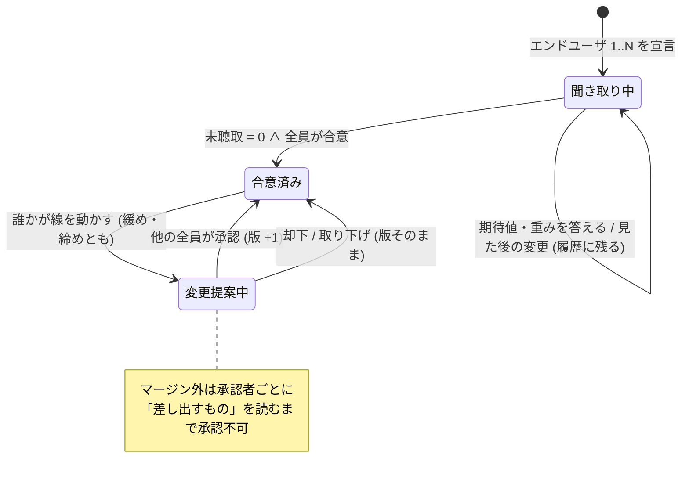

# 165. 判定基準は設計の前に聞き切る — 期待値と重みで聞き、合意した線は提案でしか動かない

- Status: Accepted (2026-10-11 — 当事者が俯瞰で合意。段階実装: D1・D2 の語彙と未聴取の census (PR1 — 済)、D4・D5 の履歴と線の版・合意・変更提案 (PR2 — 済)、D3 の聞き取りフローと D4 の合意前の半分 (PR3 — 済。案の値は PR4 へ — DEF-064)、D6 の関心と差し出すもの・案 — 契約の版上げ + core/ (PR4)。`docs/ia-redesign/03-implementation-order.md` Phase 8)
- Date: 2026-10-11
- Deciders: yuubae215, Claude
- 段: IA 再設計 Phase 8 (`docs/ia-redesign/03-implementation-order.md`)
- Retires: GREP:src/context/ContextDslSchema.js::'maintainer',\s'endUser' — 職能 (`maintainer`) と立場 (`endUser`) を同じ列挙に入れた `VALID_ROLES`。実装の PR で 2 つの欄に割れて消える
- Supersedes / Superseded by: なし (ADR-063 選択優先インテークと ADR-104 所有権・提案・証憑の上に積む)

## Context — Goal と力学 (§1.2 Goal)

### 要求 (当事者、2026-10-10〜11)

> このアプリの重要な使命は、設計する前にエンドユーザにすべての重みを聞き切ることです。
> 語彙の充足やイラストでイメージをつけてもらうことや、コスト関数的に重みでクライテリアを
> 表現できる、などいわばゲームのキャラメイク的にやってみてどうなりそうか見せてユーザに
> 選択させる

続く対話で決まったこと (記録の正本は `docs/ia-redesign/02-grouping-criteria.md`、フローの正本は
`docs/ia-redesign/criteria-charamake-flow-v4.html`):

1. エンドユーザは**立場**であって職能ではない。立つ人は保全・決裁者・生産技術・製造技術・環境安全・
   SIer など、1 人とは限らない。
2. 聞く語は **QCD + S**。現場で最初に言われるのはタクト、次に位置精度、言われないが効いているのが安全。
   重要な要素から言葉に分解する。C は設備費と保全性。
3. どの要素も**しきい値と重みの同じ形** (安全も — 人と当たらないにも、どれだけマージンを取るかがある)。
4. **しきい値 = クライテリア = 期待値**。期待値と実態の差で人の感情が変わる。
5. 結果を見て期待値が動くのはよい。ただし**履歴は残す** — 「安全はあのとき削りましたよね?」と
   言えるように。それは教育ではなく**誘導**。
6. 線の変更はゼロサムで誰かのリソースを使うので、**最初に合意した線からの変更は他のエンドユーザの
   承認が要る** (緩めるのも締めるのも)。
7. 承認の**重さは同じ**。マージン外なら**差し出すものを読ませる**。**みんなの関心のインジケータ**を出す。
8. インジケータの値を出す**コスト関数はアイデア** (core/)。隠した式の数字で合意してよい —
   **式と重みは、そのインジケータを持つ人が保証する**。

**Goal:** *設計が始まる時点で、すべてのエンドユーザの、すべての要素の期待値と重みが文書にあり、
全員が合意している。合意の後に線が動いたなら、誰が・何を見て・誰の承認で動かしたかが残っている。*

### 力学 1 — 聞かれなかった要素は行を持たない

現場で安全は「言われない」。発言を拾って行を作る聞き方では、安全の行は永久に生まれない
(原則 #31)。必要な要素を列挙し、全員 × 全要素の**空欄の個数**を数え、0 になるまで設計へ進めない。

$$
\text{未聴取} = \sum_{u \in U_{\text{end}}} \Big( |\{c \in \{D,Q,C,S\} : \text{比重 未回答}\}| + |\{e \in E : \text{期待値・重み 未回答}\}| \Big),\quad \text{設計へ} \iff \text{未聴取} = 0 \land \text{合意済み}
$$

### 力学 2 — 数値は答えられないが、結果は選べる

十数個の重みをいきなり数値で答えられる人はいない。価値木 (AHP と同じ階層) の上の段 (QCDS の比重) は
型から選んで直し、下の段は期待値と重みを図つきで聞き、最後に**案を並べて選ばせる** (選好の聞き出し —
コンジョイント分析と同じ考え方)。案の実態値と、案の選択から重みを推し量る計算は core/ の仕事。

### 力学 3 — 線はゼロサム

合意した線のどれかを動かすと、マージンが十分にあるとき以外は別の要素 = 別の誰かの線から取っている。
だから線は**合意の対象**で、動かす行為は ADR-104 の**提案**と同じ形になる。

## Options considered

- **A: 設計の前に、キャラメイク型のフローで全エンドユーザから聞き切り、合意した線を提案でだけ動かす** —
  tradeoff: 設計に入るまでの手数が増える。エンドユーザ全員の時間が要る。
- **B: 重みは設計しながら必要になったときに聞く** (今日の形 — Grasp パネルの React state) —
  tradeoff: 聞かれなかった要素 (安全) は永久に聞かれず、後から依存が見つかってループが増える (L_hidden)。
- **C: 聞き切るが、合意後の変更は本人だけで通す** — tradeoff: ゼロサムの相手が知らないうちに線が
  下がる。履歴は残っても、合意ではなくなる。
- **D: 関心の値を front で重みから計算して見せる** — tradeoff: 計算式はアイデアなので、front に
  置けば第二のコスト関数になる (CLAUDE.md §AI 向けガード 軸 1)。

## Decision — Strategy (§1.2 Strategy) — 案 A

### D1 — 職能と立場を分ける

actor は「誰か」(職能: 保全 / 生産技術 / 製造技術 / 環境安全 / 決裁者 / SIer …) と、「このプロジェクトで
エンドユーザの立場に立つか」を**別の欄**で持つ。`VALID_ROLES` が 2 種類の事実を 1 つの列挙に
入れていた形を割る (原則 #33 (1))。エンドユーザの基数は `1..N` で、0 人では聞き取りが始まらない。
Context DSL の版上げ (`context/0.6`)。

### D2 — 価値木は QCD + S、どの要素も期待値と重みの同じ形

上の段は D 速さ / Q 品質 / C コスト / S 安全 の比重。下の段の要素 (起票時の案):
D = タクト、Q = 位置精度・落とさない (保持の余裕)、C = 設備費・保全性、
S = 人と当たらない (マージン)・止めたら止まる (停止距離)。どの要素も
`{期待値 (= クライテリア), 重み (期待を超えた分の嬉しさ)}` を持つ。期待値は Context DSL の受け入れ判定の
しきい値 (L5、許容領域)、重みは目的の重みに乗る — 新しい層は作らない。
「落とさない」「止めたら止まる」は Claude が置いた案で、当事者の確認を待つ。

### D3 — 聞き取りはキャラメイク型のフロー

誰に → 比重 (型から) → 期待値と重み (図つき) → やってみる (案を並べ、期待値との差を ☺ ○ ☹ で見せる)
→ 聞き切ったか。期待値と実態の差は閉形式なので front で出してよく (軸 3)、顔と色は演出として
クライアントで導出し契約に足さない (原則 #29)。**総合点は出さない** — 重みの組み合わせ方は core/ の
スコア関数。ADR-063 の FSM (`context.wizard`) の上に載せる。

### D4 — 見た後の変更は履歴に残す (誘導の記録)

初めて「やってみる」を開いた瞬間の期待値を写し取り、以後の変更を追記のみで残す。各変更は
誰が・何を・**どの案を見た後に**を持つ。1 回の「やってみる」ごとに締めた / 緩めた要素を組にし、
「タクトを取るために人と当たらないを緩めた」の 1 文で残す。安全を緩めた組には「安全を削った」が付く。

### D5 — 合意と、合意後の変更提案

全エンドユーザが「合意する」を押すと線は **合意済み v1**。以後の線の変更は ADR-104 の**提案**
(`提案 → 承認 / 却下`) になり、**他のエンドユーザ全員**の承認で版が上がる (v2, v3 …)。承認の重さは
マージンの内外で変えない。マージン外の提案は**差し出すもの**を承認者ごとに読むまで承認を押せない。
エンドユーザが 1 人なら承認者がいないので、変更はそのまま通り「承認者なし — 記録のみ」と残る
(v8 の単独決定と同じ扱い)。

禁止遷移: `聞き取り中 → 変更提案中` (合意前に提案は無い)、`変更提案中 → 合意済み` を承認者の欠けた
まま通すこと、合意済みの線を提案を経ずに書き換えること。状態の正本は `docs/STATE_TRANSITIONS.md`
§判定基準の線 (本 ADR と同じコミットで節を起こす)。

### D6 — 関心インジケータと差し出すものは core/ が返し、持ち主が保証する

エンドユーザごと × 大項目の**関心**と、マージン外の提案が**差し出すもの**は、どちらも core/ のコスト
関数が出す (アイデア — 軸 1)。front は返った値を描くだけで、重みからも計算しない。値は本人も直接は
書き換えない — 値は入力 (重みと期待値) からの導出で、変えたければ入力を変える (合意後なら提案)。
信頼の根拠は式の公開ではなく**持ち主がいること**: 式と重みは、そのインジケータを持つ人が保証する。
response 契約に値を足すので、実装の PR で `contractVersion` を上げる (ADR-082/084)。

## Consequences — Evidence と tradeoff (§1.2 Evidence)

### 得られるもの

- 安全のように言われない要素も、空欄として数えられ、聞かれないまま設計に入れない。
- 「安全はあのとき削った」が、誰が・何を見て・誰の承認で、の形で残る。
- 線の変更がゼロサムの相手に見え、承認なしには通らない。
- 重みが Grasp パネルの React state から文書へ移る (DEF-033 の「重み」の半分が決着の形を得る)。

### 払うもの

- 設計に入るまでの手数と、エンドユーザ全員の時間。
- マージン内の変更にも承認が要る (承認疲れ — 重さを変えず、マージン外だけ読ませることで受ける)。
- 関心の値は式が見えない。説明できるのは入力 (その人の重みと期待値) までで、式そのものは説明しない。
- Context DSL と response 契約の 2 つの版上げ。

### 検証 (証拠)

論証木: `docs/gsn/adr-165-criteria-are-heard-in-full-before-design.gsn`
(goal ごとの支えの正本。起票時点ですべて support-exploring、満期は機械可読)。

### 波及 (blast radius)

| 触るもの | 中身 |
|---|---|
| `src/context/ContextDslSchema.js` / `schema/context-*.schema.json` | 職能と立場の分離、価値木 (比重・期待値・重み)、線の版と変更履歴 (`context/0.6`) |
| `src/context/WizardCatalog.js` | 聞き取りフローの定義 (ADR-063 の FSM の上) |
| `src/context/Proposal.js` / `ContextService` | 線の変更提案 (既存の提案 → 承認 / 却下を使う) |
| `packages/grasp-contract` | response に関心と差し出すもの (contractVersion 版上げ) |
| `core/` | 案の生成、関心・差し出すもの・重みの推し量り (アイデア) |
| `docs/STATE_LEDGER.md` / `docs/STATE_TRANSITIONS.md` | 線の状態と、エンドユーザ・提案の基数 (本 ADR と同じコミット) |

## Lens notes

- §1.4: 「判定基準の線」は 3 状態 (聞き取り中 / 合意済み / 変更提案中) で閾値を跨ぐ。クラスより先に
  状態機械を `docs/STATE_TRANSITIONS.md` に起こした。基数はエンドユーザ `1..N`、提案 `0..N`、
  承認者 `N−1`。
- §1.3 様態: 聞き取りは逐次 (BPMN — 誰に → 比重 → 期待値 → やってみる → 合意)、合意後の変更は
  事象駆動 (CMMN — いつ誰が線を動かすかは決まっていない)。
- 動詞境界 (ADR-056/077): 関心・差し出すもの・重みの推し量りは**提案・ランキング**の側 (core/) で、
  線と合意は**決定**の側 (文書)。front は決定を書き、提案を描く。
- 原則 #31: 数えるのは答えた数ではなく、必要な欄の中の空欄。

## 俯瞰で決まったこと

### PR1 の俯瞰 (2026-10-11、当事者が 4 点とも推奨で決定)

`/whiteboard` で語彙を引き直すと、ADR が「足す」と書いた語の半分は**既に在った**。
持ち主つきのしきい値は `requirement {by, owner, kpi, criterion}` そのもので、受領証の形
(`decision {oldCriterion, newCriterion}`) も提案の状態機械 (ADR-104) も在る。足りないのは
「立場」「重み」「比重」「要素の母集団」だけだった。

1. **職能の語彙は閉じた列挙にする。** `role` は職能だけの欄に戻し、ADR の職能を足す:
   `developer / maintainer / agent / customer` + `approver` (決裁者) / `productionEng` (生産技術) /
   `manufacturingEng` (製造技術) / `ehs` (環境安全) / `integrator` (SIer)。立場は別の欄 `endUser: true`。
2. **旧文書の `role: "endUser"` は「立場 = エンドユーザ、職能 = 未宣言」と読む。** 既定の職能で
   埋めない — R13 が職能の空欄を OpenQuestion として数える。読み替えは `ActorStance.js` 1 箇所
   (`IDENTITY_RULES` に登録)。`context/0.6` の文書がこの値を書けば error。
3. **期待値は `requirement` の行に置く (新しい節を作らない)。** kpi.name = 要素のキー、
   criterion = しきい値、owner = エンドユーザ、`weight` を足す。別の `criteria` 節を作れば
   requirement と第二の源になる (§1.1)。答えは `by` (誰が打ったか) ではなく `owner` のもの。
4. **価値木の葉は起票時の 7 つで固める** (「落とさない」= `holdMargin`、「止めたら止まる」=
   `stoppingDistance` を含む)。`CriteriaCatalog.js` が母集団で、未聴取はこの表に対して数える。

### PR1 — D1 + D2 の語彙と、未聴取の census (2026-10-11)

- **語と欄** (`context/0.6`): `actor.endUser` (立場)、`actor.mix {D,Q,C,S}` (比重)、
  `requirement.weight` (重み)。`role` の列挙から `endUser` が抜けた (Retires の GREP)。スキーマは
  `context-0.5.schema.json` → `context-0.6.schema.json` (1 ファイルが全版を覆う慣例どおり旧ファイルは消した)。
  旧値は入力として受け付け続ける (`ACCEPTED_ROLE_VALUES` — ドリフト検査が `VALID_ROLES` + 旧値に縛る)。
- **census**: `countUnheard(ctx)` (`CriteriaElicitation.js`) — 1 人 18 欄 (比重 4 + 7 要素 × 2)。
  0 人は `started: false` で、空の 0 にしない。宣言された 0 は答え (比重がすべて 0 だけは error — 比が無い)。
  同じ要素に 2 行は空欄扱い + error (どちらを数えるかを推測しない)。
- **validator**: R12 (`R12:no-end-user` / `R12:unheard-criteria` — 1 人 1 問に空欄を列挙) と
  R13 (`R13:undeclared-function`)。フォームの答えの種を 3 つ足し (`endUserStance` / `criteria` /
  `jobFunction`)、フォームの適用だけで R12・R13 が消えることをテストで焼いた。
- **表に出た既存欠陥**: R10 の答えの種 `owner` には FormPanel の入力欄が無く、問いが出るのに押すものが
  無かった (原則 #11)。適用の側は未宣言の種で throw するのに、**入力欄の側は数えていなかった**。
  `FormAnswerKinds.test.js` が `ANSWER_KIND` を母集団に、入力欄と適用がちょうど 1 つずつあることを数える。
- **本文から動いた点**: (a) 要素のラベルは英語 (UI の文言 — ADR-161。日本語の語は ADR とカタログの
  コメントに残す)。(b) 簡易の入力欄 (`CriteriaWidget` — 比重 + 要素ごとの期待値と重み) を先に置いた。
  キャラメイク型のフロー (D3) は PR3 で、これはその前の素の形 — 聞けない問いを出さないため。
  (c) GSN の D6 の goal は満期が `ADR-165` (Accepted で発火) だったので、D6 の census の住所へ張り替えた。
  (d) **期待値の行は `constrains` を持たなくてよい** (R0' の例外)。俯瞰 3 で期待値を `requirement` に置いたが、
  R0' は「requirement は設計変数を 1 つ以上縛る」を要求していた。タクトの期待値がどの設計変数に効くかは
  ソルバの写像 (core/ — 軸 1) で、エンドユーザが答えることではない。単体テストは「フォームが空になる」だけを
  見ていて error を見ていなかったので通り、**ブラウザで答えを押して初めて** ContextService の拒否が出た。
  `ContextPhase2.test.js` の完了テストに「答えた文書が error を持たない」を足した (修正を外すと 2 本落ちる)。
- **まだ無いもの**: 合意 (設計へ進む gate の後半) と線の版・履歴 (PR2)、フロー (PR3)、関心 (PR4)。

### PR2 の俯瞰 (2026-10-12、当事者が A〜D と D4 の分け方を推奨で決定)

`/whiteboard` で語彙を引き直すと、提案 (ADR-104) の状態機械と証憑はそのまま使えるが、
4 つの語が無かった: 合意の**束ね** (人ごとの合意とその時点の値の組)、承認者が `N−1` 人いる
**関係** (いまの承認は所有者の鍵 1 本で 1 回)、**却下**という終端 (いまの終端は提案者の取り下げだけ)、
「鍵があっても書けない」(いまの `DIRECT` は「鍵を持つ」と「書いてよい」を兼ねていた — 原則 #33 (1))。

- **A. 合意後にエンドユーザが増えた / 減ったら** — `合意済み` は「全エンドユーザ ∈ `agreed.by`」で導出する。
  新しい人が来れば聞き取り中 (再聴取) に落ち、R12 が名指しする。**版は保つ**。図に基数の変化による
  再聴取の辺を足した。減った人の行は線から外れる (書き換えではなく基数の変化 — drift にしない)。
- **B. 線に入るもの** — census と同じ母集団 (比重 4 + 期待値 + 重み)。数える欄と凍る欄を 2 つの表にしない (§1.1)。
- **C. 1 人の却下で終端にする** — ゼロサムの相手の拒否権。重さは承認と同じ。
- **D. ADR-104 の所有者にも `却下` を開く** — 状態集合は 1 つ (線の提案専用にすると型が 2 つに割れる)。
- **D4 の分け方** — D4 の錨は「初めてやってみるを開いた瞬間」で、やってみるは PR3。PR2 は**合意後**の履歴
  (終端に達した提案と証憑、緩めた / 締めた / 安全を削ったは導出) だけを持ち、合意前の「見た後の変更」は
  PR3 で錨と一緒に入れる (DEF-063)。マージンの G3 は欄と gate だけ置く (DEF-062)。

### PR2 — D4 (合意後) + D5 (2026-10-12)

- **語と欄**: `criteriaAgreement {agreed {line, version, by}, pending {line, by}}` (合意 = 人の行為なので保存。
  状態・現在の版・陳腐化・drift は `CriteriaLine.js` が毎回導出)。提案に `approvals[]` (集合)、承認時に
  `approversRequired` と `lineVersion` を焼き込む。`PROPOSAL_STATE.REJECTED` (終端) と `rejectedBy`。
  主張の種に `requirement.weight` と `actor.mix` (所有者は actor 自身)。スキーマは `context/0.6` のまま
  optional 追加 (Context DSL は request 側でも契約でもない文書形式 — 版は PR1 で上がっている)。
- **凍結**: 合意が覆うエンドユーザの線の欄は、所有者の鍵があっても `PROPOSE_ONLY` (`editPermission` が鍵より先に
  `isFrozenLineTarget` を問う)。ファイルを直接書き換えた形は R14 が `agreed.line ⊕ 承認済みの提案` との食い違い
  (drift) として error にする。フォームの適用も凍った欄を書けば throw する。
- **承認**: 線の提案は所有者ではなく**他のエンドユーザ全員**が承認する。承認は 1 人ずつ積み上がり、集合が揃った
  1 回が主張・状態・証憑を 1 変換で動かし (ADR-104 U1)、版を +1 する。同じ鍵の 2 度押しは集合なので数えない。
  エンドユーザが 1 人なら承認者 0 人で、そのまま通り証憑に「no other end user — recorded only」と残る。
  undo は承認ごとに足した承認者を外し、揃えた 1 回なら 3 つを一緒に巻き戻す。
- **合意**: R12 に `R12:unagreed-criteria` (答えの種 `agreement`) を足した — 未聴取 0 のときだけ問い、エンドユーザ
  ごとの「Agree as …」は本人の鍵を持つ間だけ押せる (理由は `agreementGuards` から)。合意の途中で線が変われば、
  それまでの合意は古い線への合意として数えず、集め直す。設計へ進む gate の後半はこれで名指しされる。
- **場**: `AgendaPanel` に判定基準の線の節 (状態・版・合意者、凍った欄への変更提案、合意後の履歴 — 安全を削った
  組に ⚠)。提案の行に「approved k of m」と Reject。
- **表に出た既存欠陥**: 場の read model (`agendaRows`、新しい `criteriaLine`) が**入場時に投影されていなかった** —
  後の編集の再投影でしか書かれず、ファイルを開いた直後は合意の問いが出るのに押すボタンが無かった
  (原則 #11)。単体テストは純粋層と service を見ていたので通り、**ブラウザで押して初めて**見えた (PR1 の R0' と同じ
  形)。`_startNegotiation` が両方を投影し、`ContextController.test.js` が入場直後の store を問う (修正を外すと落ちる)。
- **本文から動いた点**: (a) STATE_TRANSITIONS の「同じ人の同じ要素への新しい提案は古い提案を置き換える」は
  採らず、ADR-104 U2 の併存 + 楽観ロックのまま (置き換えは別経路からの暗黙の取り下げ = 書き手が 2 つになる)。
  (b) 合意は service の新しい入口ではなくフォームの答え (`AnswerQuestionCommand`) — 設計へ進む gate の入口を 1 つに保つ。

### PR3 の俯瞰 (2026-10-12、当事者が Q1・Q2 とも推奨で決定)

`/whiteboard` で語彙を引き直すと、比重・期待値・重みの空欄は PR1 の census を回答者で絞れば言えた
(足さない)。無かったのは 3 語だった: **回答者** (wizard は「何段目か」しか持たず、エンドユーザ 1..N の
うち今だれが答えているかを言えない — 束ねの名前)、**やってみた回** (「案 B を見た後で人と当たらないを
緩めた」の「後」の錨 — 1 語 1 事実)、**案** (案の実態値 — 語が指す先)。

- **Q1. 案はだれが出すか → PR4 にまとめる。** 案を作るのはアイデア (軸 1) で、src/ に仮の数字は置けない。
  core/ にはまだ案を作る仕組みが無く、出すなら response 契約を足して版を上げる。関心・差し出すものと
  同じ PR4 で、版上げ 1 回で入れる。PR3 の「やってみる」は、案が無いことを名指しで出し (空のまま黙らない)、
  回の写しと履歴は記録する — 見た案は `seen: []` (宣言された 0)。
- **Q2. 合意前の履歴の形 → 回の写しだけ保存。** 保存するのは人の行為 (やってみるを開いた瞬間の、その人の
  線の写し + 見た案) だけで、「回 n の後の変更」・向き・安全を削ったは写しどうしの差から毎回導く。
  変更を 1 件ずつ追記すると、要素の現在値との第二の源になる (PR2 の「人の行為だけ保存」と同じ方針)。

### PR3 — D3 の聞き取りフロー + D4 の合意前の半分 (2026-10-12)

- **語と欄**: wizard の状態に `respondent` (回答者 — wizard が開いていて エンドユーザ ≥ 1 なら 1)。文書に
  `criteriaHearing.trials[] {actor, line, seen}` (`context/0.6` のまま optional 追加)。回の番号・回 n の後の
  変更・向き・安全を削ったは `CriteriaHearing.hearingHistory` が導く。「安全を削った」の判定は
  `CriteriaLine.isSafetyCut` 1 箇所に寄せ、合意前と合意後の履歴が食い違えないようにした。
- **フロー** (`CRITERIA_HEARING_WIZARD` — ADR-063 の FSM の上): 誰に → 比重 → 期待値と重み → やってみる →
  聞き切ったか (= 合意)。段の gate は件数ではなく**回答者の空欄** (`hearingStepGaps` — census を回答者で絞る)
  なので、「次へ」が拒まれる理由は R12 が名指す空欄と同じ。wizard の段は `gaps(docLike, state)` を宣言でき、
  遷移は定義固有の欄 (`respondent`) を保つ。合意済みの回答者は Step 2〜4 を素通りし、変更は場の提案へ。
- **記録**: 「やってみる」の段を開いた瞬間 (次へ / 回答者の切り替え) に回を記録する。線が前の回と同じなら
  記録しない (行き来しただけは新しい見方ではない)。空欄があれば・合意済みなら記録しない (理由を出す)。
  最初の回より前の答えは初回の回答で、履歴にしない。
- **住所**: 聞き取りは文書の入口 (`DocIntakeLayer`) に載り、場を開いていなくても動く (gate は文書 —
  ADR-106 D4)。書き込みは場のフォームと同じ純変換 (`FormApplication` の `endUserStance` / `criteria` /
  `agreement`、`recordTrial`) を通る 1 undo の `DocEditCommand`。パネルは文書の縁で投影する
  `context.criteriaDoc` を読み、controller と同じ gate を問う (1 つの述語、2 つの投影)。
- **入口**: `Start ▾` に「Hear the criteria (end users)」(`START_KIND.CRITERIA_HEARING`)。誘導インテークの
  開始画面にも置いたが、ヘッダの誘導インテークは開始画面を飛ばして始まるので、そこだけでは到達できない
  (原則 #16)。
- **総合点は出さない**: フローのどこにも合計は無い (重みの組み合わせ方は core/ のスコア関数)。
- **表に出た既存欠陥**: wizard の「added in this document」の一覧は、知らない段の種類に対して要件の一覧へ
  落ちる else 枝を持っていた (原則 #31 — 種ごとの表の fall-through)。単体テストは通り、**ブラウザで
  やってみるの段を開いて初めて**中身の無い枠が 7 つ見えた (PR1・PR2 と同じ形)。表 `COMMITTED_BY_KIND` に
  全種を宣言し (聞き取りの段は「一覧しない」と宣言)、未宣言の種で throw する。
  `e2e/criteria-hearing.spec.js` が問う (修正を外すと落ちる)。
- **本文から動いた点**: (a) 比重は**型から選ばせていない** — 4 つの数を直接答える。型 (「止めないライン」=
  D40 Q25 C15 S20 など、フロー v4 の案) はキュレーションされた判断知に読めるので、軸 1 に当たるかを当事者に
  確かめるまで src/ に置かない (DEF-065)。(b) 期待値の段に**図が無い** (v4 の「語の確かめ」— 原則 #33 (4))。
  単位と「小さいほど良い / 大きいほど良い」の 1 行だけを置いた (DEF-065)。(c) ☺ ○ ☹ は案の実態値が要るので
  PR4 で案と一緒に置く (DEF-064)。

## 残し (PR3 時点 — 後続 PR)

- マージン外の提案で差し出すものを読ませる gate は置いたが、値 (`offerings`) と読んだ記録の押下は PR4 — DEF-062。
- やってみるの案 (core/ が返す実態値) と、期待値との差の ☺ ○ ☹、見た案の記録 (`seen`) の書き手は PR4 — DEF-064。
- 比重の型と期待値の図 (フロー v4 の Step 2・3) — 型が軸 1 に当たるかの当事者確認が先 — DEF-065。
