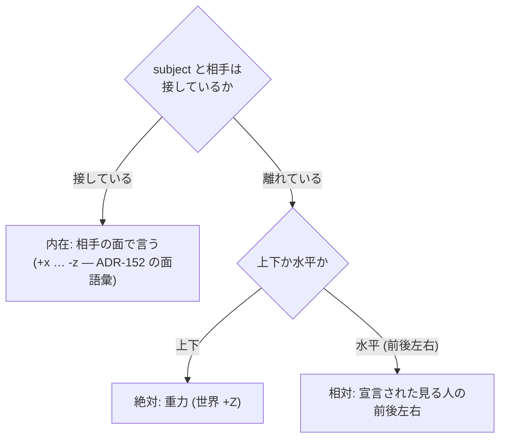

# 168. 2 つの物の関係は 1 語ではなく軸の組で言う — 向き・接触・可動性、主張は 3 つの欄に

- Status: Proposed (2026-10-21 起票 — 当事者との俯瞰で D1〜D4 の向きに合意。名前・段の切り方・O1〜O3 は未決)
- Date: 2026-10-21
- Deciders: yuubae215 (要求: 「above が載っている、なのは語彙のイメージと合わない — 離れて上方にあるイメージ」/「上下左右どっちにあるのか、くっついてるのか離れてるのか、動くのか固定なのかを表す語彙はほしくない？」/「2 つの間にワークがあるのか、挟んでいるのか」/ 参照枠の規則 / state・宣言・status の読み / 「新たな型を作りましょう」/「宣言された見る人も要りそう — 前後左右はかなり主観的」), Claude (起票)
- 状態台帳: `docs/STATE_LEDGER.md` §提案中の実体 の「2 つの物の関係」「見る人」行 (Accepted・実装済みで上の台帳へ移す)
- 段: なし (IA 再設計の順序表には載せない — 画面の住所を動かさない。実装の段は本 ADR の §段 が持つ)
- Retires: GREP:src/domain/SpatialLink.js::above\s+— Source is vertically above · GREP:src/domain/SpatialLink.js::adjacent\s+— Source and target share a boundary · GREP:src/service/SemanticInferencer.js::semanticType:\s+'above' — 向きと接触を 1 語に潰した 2 つの semanticType と、それを提案する推論。Accepted の時点でこれらが残っていれば、語は割られずに足されただけ (第二の源) になる
- Supersedes / Superseded by: ADR-038 の semanticType 語彙のうち `above` / `adjacent` の 2 語を置き換える (他の語は無改変)。ADR-041 のヒューリスティック A/B の出力先を新しい型へ移す。ADR-048 §2.2.1 の「CF ツリー = 運動学的全域木」の前提を §段 S3 で見直す (ADR-094 / ADR-167 の幾何は継承)

---

## Context — Goal と力学 (§1.2 Goal)

### 発端 — LINK NETWORK の木が「イメージと違う」

> 感覚的にはテンプレートの単腕ピックプレースだと、各ワークピースはコンテナにひも付いて
> ぶら下がってそうなんだけど、そうはなってないし…

単腕ピック&プレースのテンプレを `computeLayout()` に通すと、根が 9 個横一列、木の深さ 1、
弧 8 本でレーンは上限 5 まで埋まり、**ワーク → 供給ビンの 3 本はレーン上限であぶれて
`+1`/`+3` のバッジにしかならない**。原因は、パネルの木が `parentId` (= *持ち主*: この
フレームはどの Solid の上で定義されたか) で組まれ、「ぶら下がる」(= *取り付け*: 何と
一緒に動くか / 何に支えられているか) はすべて SpatialLink の弧の側にあること。

その直し方を詰める途中で、当事者が直すべき層を 1 段下げた:

> above が載っている、なのは語彙のイメージと合わなくない？ くっついて載るんじゃなくて、
> 離れて上方にあるイメージなんだけど

### 力学 1 — `above` と `adjacent` は 1 語 2 事実 (原則 #33-1)

コードの中で既に意味が割れている:

| 語 | 定義 (`SpatialLink.js`) | 推論 (`SemanticInferencer.js`) | テンプレの使われ方 |
|---|---|---|---|
| `above` | 鉛直に上方にある (接触を言わない) | 下面が相手の上面に**接している**とき (`CONTACT_THRESHOLD`) | 「Supply bin placed on the top」= 載っている |
| `adjacent` | 境界を共有する **または** 近くにある | 側面が**接している**とき。**どちら側かは捨てる** | — |

1 語が「向き」と「接触」を運び、使う場所ごとに片方が黙って落ちる。当事者の読み (離れて上方)
と推論の読み (接して上) は同じ語の両側である。

### 力学 2 — 言いたい文が言えない (原則 #33-2・3)

当事者が挙げた問いを、今の語彙で言えるかで表にする:

| 言いたい文 | いまの語 | 欠け |
|---|---|---|
| 「ワークは A の右にある」 | 無い (`adjacent` は側を捨てる) | 向きの語 |
| 「くっついている / 離れている」 | `above`・`adjacent` に暗黙で混ざる | 接触を独立の語に割る |
| 「動くのか / 固定か」 | `jointType` (fixed / revolute / prismatic / floating …) | **在る** — ただし `null` が「注釈だけ」の意味で、動きについて何も言っていない |
| 「A と B の間にある」「A と B で挟んでいる」 | 無い — SpatialLink は 2 者しか取らない | 3 者の束ねに名前 (新しい型) |

### 力学 3 — 前後左右は主観的で、基準は接触で切り替わる

当事者の観察 (2026-10-21):

> 側面や天底にはりついてる何かに対して言う場合は相手の物体自身の向き、
> ちょっと離して置かれている何かに対して言う場合は見ている人

空間の参照枠の 3 分類 (絶対 / 内在 / 相対) にそのまま一致する:



相対の左右は**カメラでは決められない**。カメラを回せば「左」が変わるので、文書に書いた
「左」はカメラとの第二の源になる (§1.1)。左右を文書に書くには、見る人を**宣言**して名指す
必要がある — 「前後左右はかなり主観的」(当事者) だから、誰の主観かを語の一部にする。

### 力学 4 — 主張は 3 つの欄に住む (当事者の読み)

> state は対象の主張、宣言は見る人の主張、status はお互いの共有するコスト関数みたいなもの

| 欄 | 誰の主張か | 中身 | 権威 | 基数 |
|---|---|---|---|---|
| **state** (観測) | 対象 (いまの配置) | 測った向き・接触・隙間 | ジオメトリ — **保存せず導出** (§1.1) | 対ごとに常に 1 |
| **宣言** | 見る人 | 「こうであるべき」 | 文書 | **0 か 1** — 0 は「何も言っていない」で、既定値で埋めない (原則 #31) |
| **status** | 両者が共有する物差し | 一致 / 不一致 / 宣言なし | 照合する述語 1 箇所 | 対ごとに 1 |

**ガード (CLAUDE.md §AI 向けガード、ADR-146)**: 「コスト関数」が*どれだけ外れたか*の
連続量・重み付けになった瞬間、それはアイデア (軸 1) で **`core/` だけ** に置ける
(先例: ADR-165 D6 の core 側コスト関数 J)。`src/` が持てる status は**軸ごとの離散の照合**
(公知の閉形式 — 面の接触判定・内積の符号 — 軸 3) までで、点数・総合・順位を作らない。

**Goal: 2 つ (または 3 つ) の物の関係を、向き・接触・可動性のどれについても 1 語 1 事実で
言え、言ったこと (宣言) と在ること (state) の一致が画面で読める。前後左右は誰から見ての
話かが語の一部になる。**

## Options considered

- **A: `above` の意味を「離れて上方」に固定し、`on` / `touching_*` などを足していく** —
  tradeoff: 向き × 接触 × 側の直積が語の数になる (6 向き × 2 接触 = 12 語以上)。3 者関係は
  依然言えない。語を足すたびに推論・凡例・スキーマの列挙が増える (無限成長)。
- **B: 関係を軸の組として持つ新しい型 (採用)** — tradeoff: 型を 1 つ増やし、`above` /
  `adjacent` の旧データを移行する必要がある。
- **C: 宣言をやめて全部 state (観測) で表示する** — tradeoff: 「接していなければならない」
  という*要求*が言えず、ずれ (status) が出ない。当事者の 3 欄の読みを満たさない。
- **D: 現状維持** — LINK NETWORK の木が組めない (「載っている」と「上方にある」が区別
  できないので、支えの関係を取り出せない)。

## Decision — Strategy (§1.2 Strategy)

### D1. 関係は 3 軸の組。各軸は「宣言なし」を独立した値に持つ

| 軸 | 値 | 正本 |
|---|---|---|
| **接触** | `touching` / `apart` (隙間 mm は任意) / 宣言なし | 新しい型 (D3) |
| **向き** | 接しているとき: 相手の面 `+x … -z` (内在 — **ADR-152 の面語彙を使い、新しい語を足さない**)。離れているとき: `above` / `below` (絶対) と、見る人を名指した `front` / `back` / `left` / `right` (相対 — D2) / 宣言なし | 新しい型 (D3) |
| **可動性** | **既存の `jointType`** をそのまま使う。subject と相手の間の SpatialLink の `jointType` が可動性の宣言。リンクが 0 本 = 宣言なし、1 本 = その値 (`floating` = 自由)、運動学リンクが 2 本以上 = 矛盾 (バリデータのエラー) | `SpatialLink.jointType` (無改変 — 第二の源を作らない) |

接触の判定は 1 つの許容値で行い、その許容値の正本は 1 箇所に置く (今の
`SemanticInferencer.CONTACT_THRESHOLD` を源にする)。

### D2. 「見る人」を宣言できる。カメラは見る人ではない

- 見る人は位置と正面を持つ座標系として宣言する (正面 = +X、左 = +Y — ROS REP-103)。
  既存の `CoordinateFrame` に役割を 1 つ足す形 (`robotRole` と同じ形の役割欄) を第一候補にする
  — 新しい実体種を足すかは S1 で決める (O1)。
- **相対の向き (前後左右) を宣言する関係は、見る人を必ず名指す。** 名指しの無い相対の向きは
  書けない (バリデータのエラー)。見る人が 1 人しかいなくても暗黙に選ばない (原則 #31 —
  0 / 1 / N のどれでも「どれのことか」を推論させない)。
- 見る人を宣言していないシーンでも、画面は**今のカメラから見た左右を表示として導出**して
  よい (原則 #29 — 演出はクライアント)。それは文書に書かれず、status の照合にも使わない。

### D3. 新しい型 — 1 つの subject と、1 つまたは 2 つの「側」

仮称 `Arrangement` (名前は S1 で確定 — O2)。2 者関係も 3 者関係も同じ型で言う:

```
Arrangement {
  subject: <ref>                       // 関係の主語 (例: ワーク)
  sides:   1..2 × {
    of:      <ref>                     // 相手
    contact: touching | apart(gap?)    // D1 — 省略 = 宣言なし
    toward:  <face> | above | below
             | { dir: front|back|left|right, viewer: <ref> }   // D1 / D2 — 省略 = 宣言なし
  }
}
```

| sides | 両側の contact | 読み |
|---|---|---|
| 1 | touching / apart | 2 者の関係 (旧 `above` / `adjacent` の置き換え先) |
| 2 (向きが逆) | 両方 touching | **挟まれている** |
| 2 (向きが逆) | 両方 apart | **間にある** |
| 2 (向きが逆) | 片方だけ touching | 片側に寄って間にある |

- sides の基数: **0 は表現不能** (相手の無い関係は関係ではない — スキーマの `minItems`)。
  **3 以上は「まだ決めていない」** (囲む・並ぶ。容器の中は既存の `contains` が言う)。
- 2 側の向きが逆向きでない (例: 両方 `left`) 組は「間」を言わないのでバリデータのエラー。
- 可動性は型の中に持たない (D1 — `jointType` が正本)。表示と status の照合では、subject と
  各側の間の SpatialLink から**引く**。

### D4. 主張の 3 欄 (力学 4)

- **state** は配置から導出する純粋関数 1 つ (`src/domain/` — 閉形式の幾何: 接触 = 面の符号付き
  距離 `|g| ≤ ε`、上下 = `z_s,min − z_t,max` の符号、相対 = 位置差を見る人の座標系へ写した
  `x` (前後)・`y` (左右) の符号、内在 = 接触点が乗る相手の面)。保存しない。
- **宣言**は D3 の型 (文書)。省いた軸は「宣言なし」で、既定値を入れない。
- **status** は軸ごとに `一致 / 不一致 / 宣言なし` の 3 値。合計・点数・順位は作らない
  (ガード — 連続量のコストは `core/`)。不一致は画面で必ず見える (原則 #11)。

## 段 (この ADR の実装順)

| 段 | 内容 | Accepted 条件への寄与 |
|---|---|---|
| **S1** | 型の名前・見る人の形 (O1/O2) を決め、Layout DSL のスキーマ (`schema/layout-1.0` → 版上げ) と domain の型、state の純粋関数と status を入れる | D1〜D4 |
| **S2** | `SemanticInferencer` の A/B を新しい型の提案へ移し、テンプレの `above` を移行する (bin・tray・pedestal → `touching` で作業台の `+z` 面)。scene ファイルの旧 `above` / `adjacent` は読み込み時に無損失で移行 (先例: ADR-152 の `faces` → `specs`) | Retires の 3 番地を消す |
| **S3** | LINK NETWORK の木を軸から導く: 親 = subject を**固定** (`jointType: fixed`) する相手、または subject を**下から支える**相手 (`touching` かつ 相手の上向きの面)。候補が 2 つ以上なら固定が支えに優先し、残りは弧 (無言で消さない)。循環は 1 本を弧に回す | 発端の苦情 |

## Consequences — Evidence と tradeoff (§1.2 Evidence)

- 肯定的: 当事者の問い (どちら側か・接しているか・動くか・間か挟みか) がすべて 1 つの型と
  既存の `jointType` で言える。語の数は軸の値の和で増え、直積では増えない。宣言と配置の
  ずれが status として出る。LINK NETWORK の「ぶら下がる」が語彙から導ける (S3)。
- 受け入れるコスト: 型が 1 つ増える。Layout DSL / scene のスキーマ版上げと旧データの移行。
  見る人という主観を文書に持ち込む (ただし必ず名指しされる)。
- 波及 (blast radius): フロントだけ — `schema/layout-1.0` / `schema/scene-1.3` の
  semanticType 列挙、`SpatialLink`、`SemanticInferencer`、`SceneImporter`、`LayoutCompiler`
  / `LayoutDecompiler`、テンプレ群、`LinkNetworkLayout` (S3)、`SpatialLinkView` の凡例。
  **`core/` (Python) は semanticType を一切読まない** (`grep -rn "above\|adjacent" core/` —
  テストのカメラ名のみ。2026-10-21 確認) ので、grasp 契約と contractVersion には触らない。
- 検証 (証拠): goal ごとの支えの正本は論証木 `docs/gsn/adr-168-a-spatial-relation-is-three-axes.gsn`
  (起票時点ではすべて未支持で、証拠予定を `assumption` に名指ししてある)。

## 未決 (O)

- **O1** 見る人は `CoordinateFrame` の役割か、新しい実体種か。
- **O2** 型の名前 (仮称 `Arrangement`)。
- **O3** 「見る人」(位置と正面 — 幾何) と「主張した人」(誰が言ったか — `PersonaProjection`
  の `by`) は同じ事実か。当事者の読み「宣言は見る人の主張」では一致するが、1 語 1 事実
  (原則 #33-1) の候補として S1 で問う。

## Lens notes

- §1.1: 可動性の語は足さない (`jointType` が既に在る — 「語彙が既に在るなら足さない」)。
  面の語も足さない (ADR-152)。state は保存しない (配置との第二の源になる)。
- 原則 #31: 各軸の「宣言なし」・sides の基数 (0 は表現不能 / 3+ は未決)・見る人の基数
  (0 なら相対の宣言は書けない、N なら名指し) をすべて宣言した。
- 原則 #29: カメラ相対の左右は表示の導出で、文書に載らない。
- ADR-146: status は離散の照合まで。連続量のコストは `core/`。
