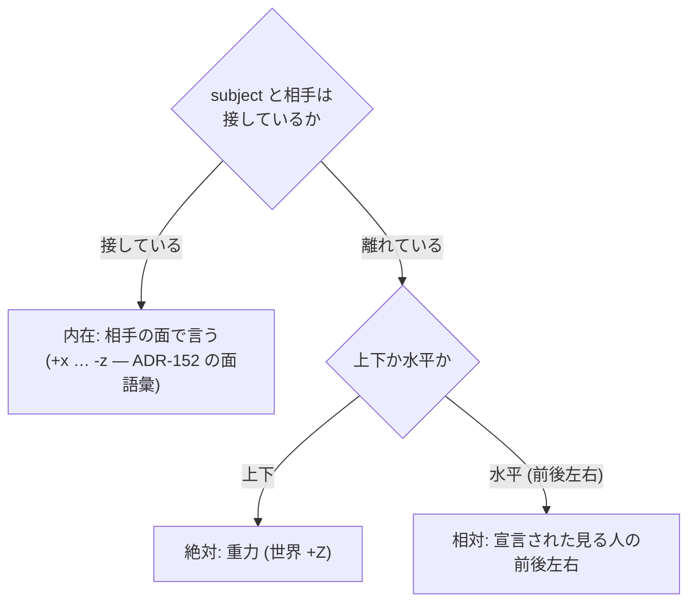

# 168. 2 つの物の関係は 1 語ではなく軸の組で言う — 向き・接触・可動性、主張は 3 つの欄に

- Status: Accepted (2026-10-22 — 当事者が「ここまで ok です。進んでください」で採択。**段階実装: S1 実装済み** (型・スキーマ context/0.7・state・status・主張どうしの衝突・R15・`frameRole` の往復 — 下の「実装メモ (S1)」)。2026-10-24 に**辞書を整備** (同義語辞書に分類 `spatial` — 下の「実装メモ (辞書)」)。同日 **S1b 実装** (語が指す先を画面で確かめる — 下の「実装メモ (S1b)」)。2026-10-25 に **D1 を改訂** (離れていても面の語で側を言える) し、辞書の二択を外した (下の「実装メモ (内在の側と二択)」)。同日、組の表 (載っている) と、語ごとの意味・例文を足し (「実装メモ (組の表と例文)」)、接触 × 向きのマスの表を先に置いて辞書をマスへの指し方に作り替えた (「実装メモ (マスの表)」)。同日 **S2-1 実装** (話している人と推論の置き換え — 「実装メモ (S2-1)」)。2026-10-26 **S2-2 実装** (旧語の退役と移行 — 「実装メモ (S2-2)」。DEF-071 決着)。S3 は未着手で、満期は論証木が持つ) — 起票時: Proposed (2026-10-21 — 俯瞰で D1〜D4 の向きに合意、同日 O1〜O3 を当事者が決定し D5 と概念モデル `docs/SPATIAL_RELATION_MODEL.md` を足した)
- Date: 2026-10-21
- Deciders: yuubae215 (要求: 「above が載っている、なのは語彙のイメージと合わない — 離れて上方にあるイメージ」/「上下左右どっちにあるのか、くっついてるのか離れてるのか、動くのか固定なのかを表す語彙はほしくない？」/「2 つの間にワークがあるのか、挟んでいるのか」/ 参照枠の規則 / state・宣言・status の読み / 「新たな型を作りましょう」/「宣言された見る人も要りそう — 前後左右はかなり主観的」/ O1「CoordinateFrame の役割で」・O2「Arrangement でいい」・O3「一人だったらそうなんだけど、複数人いたら一致しない場合もある」/「語彙が主観で変化するだろうから、データ構造か概念モデルで残しておいたほうが良い」), Claude (起票)
- 状態台帳: `docs/STATE_LEDGER.md` の「2 つの物の関係」「見る人」行 (S1 の実装で §提案中の実体 から台帳本体へ移した)
- 段: なし (IA 再設計の順序表には載せない — 画面の住所を動かさない。実装の段は本 ADR の §段 が持つ)
- Retires: なし — 退役させる `above` / `adjacent` (2 つの semanticType と、それを提案する推論) は S2 で消える。Accepted (S1) の時点では消せないので、退役ではなく**残し**として `docs/DEFERRAL_LEDGER.md` DEF-071 に降ろした (ADR-125 — 起票時はここに 3 番地を書いていた)。S2 が入ったとき DEF-071 が発火し、消えていなければ語は割られずに足されただけ (第二の源) になる。**2026-10-26 の S2-2 で消え、DEF-071 は決着した** (残っていないことは `src/layout/LegacyRelations.test.js` の census が問う)
- Supersedes / Superseded by: ADR-038 の semanticType 語彙のうち `above` / `adjacent` の 2 語を置き換える (他の語は無改変)。ADR-041 のヒューリスティック A/B の出力先を新しい型へ移す。ADR-048 §2.2.1 の「CF ツリー = 運動学的全域木」の前提を §段 S3 で見直す (ADR-094 / ADR-167 の幾何は継承)

---

## Context — Goal と力学 (§1.2 Goal)

### 発端 — LINK NETWORK の木が「イメージと違う」

> 感覚的にはテンプレートの単腕ピックプレースだと、各ワークピースはコンテナにひも付いて
> ぶら下がってそうなんだけど、そうはなってないし…

単腕ピック&プレースのテンプレを `computeLayout()` に通すと、根が 9 個横一列、木の深さ 1、
弧 8 本でレーンは上限 5 まで埋まり、**ワーク → 供給ビンの 3 本はレーン上限であぶれて
`+1`/`+3` のバッジにしかならない**。原因は、パネルの木が `parentId` (= *持ち主*: この
フレームはどの Solid の上で定義されたか) で組まれ、「ぶら下がる」(= *取り付け*: 何と
一緒に動くか / 何に支えられているか) はすべて SpatialLink の弧の側にあること。

その直し方を詰める途中で、当事者が直すべき層を 1 段下げた:

> above が載っている、なのは語彙のイメージと合わなくない？ くっついて載るんじゃなくて、
> 離れて上方にあるイメージなんだけど

### 力学 1 — `above` と `adjacent` は 1 語 2 事実 (原則 #33-1)

コードの中で既に意味が割れている:

| 語 | 定義 (`SpatialLink.js`) | 推論 (`SemanticInferencer.js`) | テンプレの使われ方 |
|---|---|---|---|
| `above` | 鉛直に上方にある (接触を言わない) | 下面が相手の上面に**接している**とき (`CONTACT_THRESHOLD`) | 「Supply bin placed on the top」= 載っている |
| `adjacent` | 境界を共有する **または** 近くにある | 側面が**接している**とき。**どちら側かは捨てる** | — |

1 語が「向き」と「接触」を運び、使う場所ごとに片方が黙って落ちる。当事者の読み (離れて上方)
と推論の読み (接して上) は同じ語の両側である。

### 力学 2 — 言いたい文が言えない (原則 #33-2・3)

当事者が挙げた問いを、今の語彙で言えるかで表にする:

| 言いたい文 | いまの語 | 欠け |
|---|---|---|
| 「ワークは A の右にある」 | 無い (`adjacent` は側を捨てる) | 向きの語 |
| 「くっついている / 離れている」 | `above`・`adjacent` に暗黙で混ざる | 接触を独立の語に割る |
| 「動くのか / 固定か」 | `jointType` (fixed / revolute / prismatic / floating …) | **在る** — ただし `null` が「注釈だけ」の意味で、動きについて何も言っていない |
| 「A と B の間にある」「A と B で挟んでいる」 | 無い — SpatialLink は 2 者しか取らない | 3 者の束ねに名前 (新しい型) |

### 力学 3 — 前後左右は主観的で、基準は接触で切り替わる

当事者の観察 (2026-10-21):

> 側面や天底にはりついてる何かに対して言う場合は相手の物体自身の向き、
> ちょっと離して置かれている何かに対して言う場合は見ている人

空間の参照枠の 3 分類 (絶対 / 内在 / 相対) にそのまま一致する:



相対の左右は**カメラでは決められない**。カメラを回せば「左」が変わるので、文書に書いた
「左」はカメラとの第二の源になる (§1.1)。左右を文書に書くには、見る人を**宣言**して名指す
必要がある — 「前後左右はかなり主観的」(当事者) だから、誰の主観かを語の一部にする。

### 力学 4 — 主張は 3 つの欄に住む (当事者の読み)

> state は対象の主張、宣言は見る人の主張、status はお互いの共有するコスト関数みたいなもの

| 欄 | 誰の主張か | 中身 | 権威 | 基数 |
|---|---|---|---|---|
| **state** (観測) | 対象 (いまの配置) | 測った向き・接触・隙間 | ジオメトリ — **保存せず導出** (§1.1) | 対ごとに常に 1 |
| **宣言** | 主張した人 (`by` — 当事者の言葉では「見る人」。D5 で幾何の見る人と割った) | 「こうであるべき」 | 文書 | **主張した人ごとに 0 か 1** (全体で 0..N) — 0 は「何も言っていない」で、既定値で埋めない (原則 #31) |
| **status** | 両者が共有する物差し | 一致 / 不一致 / 宣言なし | 照合する述語 1 箇所 | 対ごとに 1 |

**ガード (CLAUDE.md §AI 向けガード、ADR-146)**: 「コスト関数」が*どれだけ外れたか*の
連続量・重み付けになった瞬間、それはアイデア (軸 1) で **`core/` だけ** に置ける
(先例: ADR-165 D6 の core 側コスト関数 J)。`src/` が持てる status は**軸ごとの離散の照合**
(公知の閉形式 — 面の接触判定・内積の符号 — 軸 3) までで、点数・総合・順位を作らない。

**Goal: 2 つ (または 3 つ) の物の関係を、向き・接触・可動性のどれについても 1 語 1 事実で
言え、言ったこと (宣言) と在ること (state) の一致が画面で読める。前後左右は誰から見ての
話かが語の一部になる。**

## Options considered

- **A: `above` の意味を「離れて上方」に固定し、`on` / `touching_*` などを足していく** —
  tradeoff: 向き × 接触 × 側の直積が語の数になる (6 向き × 2 接触 = 12 語以上)。3 者関係は
  依然言えない。語を足すたびに推論・凡例・スキーマの列挙が増える (無限成長)。
- **B: 関係を軸の組として持つ新しい型 (採用)** — tradeoff: 型を 1 つ増やし、`above` /
  `adjacent` の旧データを移行する必要がある。
- **C: 宣言をやめて全部 state (観測) で表示する** — tradeoff: 「接していなければならない」
  という*要求*が言えず、ずれ (status) が出ない。当事者の 3 欄の読みを満たさない。
- **D: 現状維持** — LINK NETWORK の木が組めない (「載っている」と「上方にある」が区別
  できないので、支えの関係を取り出せない)。

## Decision — Strategy (§1.2 Strategy)

### D1. 関係は 3 軸の組。各軸は「宣言なし」を独立した値に持つ

| 軸 | 値 | 正本 |
|---|---|---|
| **接触** | `touching` / `apart` / 宣言なし (隙間 mm の宣言は DEF-072 — 実装メモ) | 新しい型 (D3) |
| **向き** | 接しているとき: 相手の面 `+x … -z` (内在 — **ADR-152 の面語彙を使い、新しい語を足さない**)。**離れているときも面の語でその面が向いている側を言える** (2026-10-25 改訂 — 下の「実装メモ (内在の側と二択)」)。離れているとき: `above` / `below` (絶対) と、見る人を名指した `front` / `back` / `left` / `right` (相対 — D2) / 宣言なし | 新しい型 (D3) |
| **可動性** | **既存の `jointType`** をそのまま使う。subject と相手の間の SpatialLink の `jointType` が可動性の宣言。リンクが 0 本 = 宣言なし、1 本 = その値 (`floating` = 自由)、運動学リンクが 2 本以上 = 矛盾 (バリデータのエラー) | `SpatialLink.jointType` (無改変 — 第二の源を作らない) |

接触の判定は 1 つの許容値で行い、その許容値の正本は 1 箇所に置く (今の
`SemanticInferencer.CONTACT_THRESHOLD` を源にする)。

### D2. 「見る人」を宣言できる。カメラは見る人ではない

- 見る人は位置と正面を持つ座標系として宣言する (正面 = +X、左 = +Y — ROS REP-103)。
  **既存の `CoordinateFrame` の役割 `viewer` として持つ** (O1 — 当事者決定 2026-10-21。新しい
  実体種は足さない)。役割を載せる欄は `robotRole` に相乗りしない — 名前が「ロボットの役割」を
  言っているので、相乗りすると 1 語 2 事実になる。欄の名前は S1 で決める。
- **相対の向き (前後左右) を宣言する関係は、見る人を必ず名指す。** 名指しの無い相対の向きは
  書けない (バリデータのエラー)。見る人が 1 人しかいなくても暗黙に選ばない (原則 #31 —
  0 / 1 / N のどれでも「どれのことか」を推論させない)。
- 見る人を宣言していないシーンでも、画面は**今のカメラから見た左右を表示として導出**して
  よい (原則 #29 — 演出はクライアント)。それは文書に書かれず、status の照合にも使わない。

### D3. 新しい型 — 1 つの subject と、1 つまたは 2 つの「側」

**`Arrangement`** (O2 — 当事者決定 2026-10-21)。2 者関係も 3 者関係も同じ型で言う:

```
Arrangement {
  by:      <actor ref>                 // D5 — 誰の主張か (必須)
  subject: <ref>                       // 関係の主語 (例: ワーク)
  sides:   1..2 × {
    of:      <ref>                     // 相手
    contact: touching | apart          // D1 — 省略 = 宣言なし (隙間 mm は DEF-072)
    toward:  <face> | above | below
             | { dir: front|back|left|right, viewer: <ref> }   // D1 / D2 — 省略 = 宣言なし
  }
}
```

| sides | 両側の contact | 読み |
|---|---|---|
| 1 | touching / apart | 2 者の関係 (旧 `above` / `adjacent` の置き換え先) |
| 2 (向きが逆) | 両方 touching | **挟まれている** |
| 2 (向きが逆) | 両方 apart | **間にある** |
| 2 (向きが逆) | 片方だけ touching | 片側に寄って間にある |

- sides の基数: **0 は表現不能** (相手の無い関係は関係ではない — スキーマの `minItems`)。
  **3 以上は「まだ決めていない」** (囲む・並ぶ。容器の中は既存の `contains` が言う)。
- 2 側の向きが逆向きでない (例: 両方 `left`) 組は「間」を言わないのでバリデータのエラー。
- 可動性は型の中に持たない (D1 — `jointType` が正本)。表示と status の照合では、subject と
  各側の間の SpatialLink から**引く**。

### D4. 主張の 3 欄 (力学 4)

- **state** は配置から導出する純粋関数 1 つ (`src/domain/` — 閉形式の幾何: 接触 = 面の符号付き
  距離 `|g| ≤ ε`、上下 = `z_s,min − z_t,max` の符号、相対 = 位置差を見る人の座標系へ写した
  `x` (前後)・`y` (左右) の符号、内在 = 接触点が乗る相手の面)。保存しない。
- **宣言**は D3 の型 (文書)。省いた軸は「宣言なし」で、既定値を入れない。
- **status** は軸ごとに `一致 / 不一致 / 宣言なし` の 3 値。合計・点数・順位は作らない
  (ガード — 連続量のコストは `core/`)。不一致は画面で必ず見える (原則 #11)。

### D5. 「見る人」と「主張した人」は別の事実 (O3)

当事者 (2026-10-21): 「一人だったらそうなんだけど、複数人いたら、一致しない場合もあるのでない？」

| 語 | 事実 | 正本 |
|---|---|---|
| **見る人** (`viewer`) | どこから・どちらを向いて見ての前後左右か (幾何) | `CoordinateFrame` の役割 `viewer` (D2) |
| **主張した人** (`by`) | 誰がそう言ったか | **既存の Context DSL の `actors`** (要件の `by` と同じ語 — 新しい語を足さない) |

- 宣言は必ず `by` を持つ。相対の向きを使う側は、それに加えて `viewer` を持つ。
  主張した人と見る人の対応は**推論しない**。1 人で自分の立ち位置から言うなら 2 つが同じ人を
  指すだけで、他人の立ち位置から言うこともできる (作業者の位置から設計者が言う、など)。
- **同じ対について、主張した人ごとに宣言は 0..1、全体では 0..N。** 別の人の宣言を上書きしない。
  宣言どうしが同じ軸で食い違うことは、配置との status (D4) とは**別の**事実として出す
  (「主張どうしの衝突」 — Context DSL の衝突 `conflict.between` と同じ形で、どの主張が
  ぶつかっているかを名指す)。どちらが正しいかは決めない (決めるのは合意 — ADR-165 の線と
  同じ考え方)。
- **語そのものも人によって変わる** (「奥」と言う人も「後ろ」と言う人もいる)。人ごとの言い方は、
  キュレーションした同義語の辞書 (`QUOTIENT_TABLE` — ADR-056) で D1 の正規の値へ落とす。
  これは決定的な core の正攻法の拡張点で、提案のレーン (embedding) には混ぜない。

これらの関係 (語・実体・誰が言ったか) は、語彙が変わるたびに書き換わる**生きた概念モデル**
なので、ADR (決定の記録) ではなく `docs/SPATIAL_RELATION_MODEL.md` を正本にする。
この ADR は決定の理由だけを持ち、モデルの図と語の表を写さない (§1.1)。

## 段 (この ADR の実装順)

| 段 | 内容 | Accepted 条件への寄与 |
|---|---|---|
| **S1** ✓ | `Arrangement` と `viewer` 役割の欄をスキーマへ入れる (座席は Context 文書の最上位 `arrangements[]` — 主張した人 `actors` と同じ文書に住む。見る人は Layout の `frameRole`)、domain の型、state の純粋関数、status (配置との照合) と主張どうしの衝突 | D1〜D5 |
| **S1b** ✓ | **語が指す先を画面で確かめる手段** (原則 #33-4 — 概念モデル §3 の右端の列): 接している面を光らせる / 見る人の位置と正面の矢印 / status の不一致と主張どうしの衝突を画面に出す。置き場所 `src/view/ArrangementStatusView.js` (絵の導出は `ArrangementStatusMath.js`、パネルは N パネルの Relations 節) | D4 の「不一致は画面で必ず見える」 |
| **S2-1** ✓ | **話している人** (Relations 節で選ぶ actor — 0..1、既定値なし、保存しない) と、`SemanticInferencer` の A/B を新しい型の提案へ置き換える (閉形式の接触を話している人の名前で差し出し、点数・順位を持たない。受けると文書へ主張として書く) | 推論側の Retires (A/B と 0.15) を消す |
| **S2-2** ✓ | 旧 `above` / `adjacent` の退役: 定義・手動メニュー・凡例・スキーマの enum。旧データは読み込み時に**持ち主のいない旧主張** (`unclaimedRelations: [{subject, of, cell, was}]` — `cell` はマスの ID、layout-1.1 / scene-1.4) へ無損失で移し、保存時に書き戻す。話している人を選ぶと旧主張を主張に移せる。テンプレ 4 本は作者の意図どおり `cell: touching:+z` で書く | 語の定義の Retires を消す (DEF-071) |
| **S3** | LINK NETWORK の木を軸から導く: 親 = subject を**固定** (`jointType: fixed`) する相手、または subject を**下から支える**相手 (`touching` かつ 相手の上向きの面)。候補が 2 つ以上なら固定が支えに優先し、残りは弧 (無言で消さない)。循環は 1 本を弧に回す | 発端の苦情 |

## 実装メモ (S1 — 2026-10-22)

実装で決めたこと・見つけたこと (俯瞰との食い違いは隠さず書く — 原則 #19):

- **座席:** `Arrangement` は Context 文書の最上位 `arrangements[]` (context/0.7 — 加算。版上げは
  0.5 → 0.6 と同じく schema ファイルの改名で行った)。主張した人 (`actors`) と同じ文書に住むので
  `by` が参照で閉じる。Layout DSL は幾何の事実だけを持ち、見る人は `frameRole: "viewer"` として
  そこに載る (scene JSON・保存・逆コンパイルまで往復)。
- **欄の名前:** `frameRole` (`robotRole` に相乗りしない)。値の解釈は `src/domain/viewerFrame.js`
  1 箇所で、`IDENTITY_RULES` に登録した。見る人はロボットのフレーム・視覚カメラ・TF の子にはなれない
  (カメラは +Z が視線で、見る人は +X が正面 — 同じフレームが両方だと片方の語が別の軸を指す。TF の子は
  親が動くと「左」が動くので、まだ決めていない)。
- **state の幾何 (閉形式):** 相手の座標系で subject の 8 頂点の区間を取り、軸ごとの符号付き分離から
  接触・面を読む。容器 (ADR-155) は `hollowBody.shellParts` の床と壁で読むので、ビンの中のワークは
  **内側の床の +z** に接して見える (外箱で読むと「めり込み」になる)。回転した subject は区間で
  外接するので、縁では接触寄りに読む (近似は `arrangementGeometry.js` の冒頭に明記)。
  観測の接触には宣言できない値 `overlapping` (めり込み) がある。
- **接触の許容値は mm で宣言した** (`CONTACT_TOLERANCE_MM = 1`)。既存の
  `SemanticInferencer.CONTACT_THRESHOLD = 0.15` は単位が「units」で、mm の世界 (ADR-136) では
  0.15 mm を意味する — メートル時代の残り。推論をこの定数へ移すのは S2 (DEF-071)。
- **見つけた衝突: 同義語辞書の 1 語は辞書全体で 1 つの鍵にしか落ちない。** `QUOTIENT_TABLE` は
  `above` / `below` / `between` を既に比較演算子の同義語として持っているので、空間の語を足すと
  演算子の読みが黙って変わる。D5 の「人ごとの言い方を辞書で正規形へ」は、分類ごとに引ける辞書を
  決めてから行う (→ 2026-10-24 に決着 — 下の「実装メモ (辞書)」)。1 語 1 事実 (原則 #33-1) が辞書の層にも在った例。
- **隙間の宣言 (`apart` + mm) は S1 に入れていない。** 観測の `gap` は相手の軸に沿った分離の
  **下界**で、真の距離ではないので、宣言の mm と照合すると嘘の一致・不一致を出す (DEF-072)。

## 実装メモ (辞書 — 2026-10-24)

当事者: 「設計実装の前には、辞書を整備してから進めるようにしてね。ごちゃごちゃするし」。
S1b / S2 に入る前に辞書を整えた。

- **分類ごとの引き方 (`CATEGORY_SCOPE`)。** 辞書の各分類が引き方を宣言する: 既存の 5W1H の 5 分類は
  `global` (分類を問わない `canonicalKey` — 従来どおり。`CanonicalForm` の署名は変わらない)、
  `spatial` は `scoped` (`canonicalKeyIn(term, 'spatial')` でだけ引ける)。宣言の無い分類は読み込みで
  throw する (原則 #31)。**同じ引き方の中で 1 語が 2 つの鍵に落ちるのも読み込みで throw** — それまでは
  後勝ちの上書きで、衝突は下流で誤った読みとして現れるまで見えなかった。
- **`spatial` の 14 行。** 鍵 = domain の正規形 (`touching` `apart` `above` `below` `front` `back` `left`
  `right` `+x … -z`)、日英の言い方 (奥 → back、手前 → front、くっついてる → touching、上面 → +z …)。
  鍵と domain の語彙は `src/SpatialRelationModelDoc.test.js` が両向きに縛る — 辞書の行の無い語を
  コードに足すと、その場で落ちる。
- **辞書に入れない語。** 「上」「下」「横」「載っている」は 2 つの事実を言うか、2 つのどちらかを
  話し手に代わって選ぶ (上 = 離れて above か、接して +z か)。辞書は落とさず `null` を返し、話し手に問う。
- **書く瞬間の問い所。** `/whiteboard` §0 に「辞書を先に整備する」を足した (語が決まったら機構より先に
  辞書の行と概念モデルの行を置く)。機械側の問い所は上の census と辞書の読み込み時の throw。

## 実装メモ (S1b — 2026-10-24)

語が実物のどこを指すかを、走らせる前に画面で見る (原則 #33-4 — 概念モデル §3 の右端の列)。

**読み方は実装の前に当事者が決めた** (2026-10-24 の俯瞰 — 一度目の S1b は俯瞰の前に実装されて取り消された。
CLAUDE.md §ADR の段の実装)。下の各項はこの 5 つの決定の実装である:

| 問い | 決定 | 退けた案 |
|---|---|---|
| A. D4「不一致は画面で必ず見える」の読み | 何も選んでいないときは不一致・衝突を含む関係だけを描き、物を選ぶとその物を名指す関係をすべて描く | 選んだときだけ描く (不一致はパネルだけ) / 常に全部描く |
| B. 絵と status を何から導出するか | **文書の解決済みの姿勢** (status を決めたのと同じ姿勢)。ドラッグ中は確定前の絵が残り、確定の書き戻し (ADR-129 D1) で読み直す | 今のシーンから (status の正本が文書と 2 つになり、ドラッグ中の姿勢を読む閉路 — 原則 #24 — を作る) / ドラッグ中だけ絵を隠す (view がジェスチャの状態を知る線が増える) |
| C. status を色で言うか | **C4**: 絵は中立の 1 役割、status は別の印 (✓ / ✗ / –)、**不一致と衝突の印だけ** `cautionTone` | 一致 = 緑 / 不一致 = 琥珀 (1 つの絵が「指す先」と「合っているか」の 2 事実を運ぶ。緑は「配置が正しい」と読まれるが D5 はどちらが正しいかを決めない) / 色を使わない (D4 の「必ず見える」に前注意の色が効かない) |
| D. パネル | N パネルに常設の Relations 節 (原則 #15) | viewport だけ |
| E. 動き (原則 #30) | 静止 (塗りだけ) | 接触面を一度光らせる (Fact) |

- **語ごとの絵は表 1 つ** (`CONFIRMATION_BY_WORD` — `src/view/ArrangementStatusMath.js`)。母集団は domain の語彙
  (`CONTACTS` ∪ 面 ∪ `above`/`below` ∪ 前後左右) で、絵の行が無い語の個数 0 と、domain に無い語の行の個数 0 を
  `src/view/ArrangementConfirmation.test.js` が両向きに問う (先例: ADR-152 の `CONFIRMATION_BY_FIELD`)。
  `touching` = 接している面の矩形 (容器は内側の床に — `arrangementGeometry.contactPatches`。`observeContact` と
  同じ分離の読み `partReadings` を共有するので、描いた面と読んだ接触は食い違えない)、`apart` = 2 つの中心を結ぶ
  破線と隙間 (≥ — 下界。DEF-072)、面 = 相手の外箱の該当面、`above`/`below` = 相手の上面 (下面) から subject の
  下面 (上面) への鉛直線、前後左右 = 見る人の位置と正面 (+X) の矢印、相手の中心を通る見る人の X・Y の 2 本の線
  (`observeRelative` が読む境界そのもの) と 4 つの側の名前。
- **絵は判定しない、印が言う (C4)。** 語の絵はすべて `PICTURE_TONE` (= `entityDefault`) 1 役割で描く — ADR-152 D6 の
  「確認の絵は判定をしない」はここでも保つ (ただし理由は違う: ここの status は front が決めた離散の照合 — ADR-146
  軸 3 — で、色を避ける理由は「1 つの塗りに 2 事実を載せない」と「一致を正しさに見せない」)。status はキャプションと
  パネルの印 ✓ / ✗ / – で言い (色覚に頼らない)、色が付くのは不一致と衝突だけ (`cautionTone`、ADR-100 — 新しい色を
  足さない)。一致は `textPrimary`、宣言なしは `textSecondary`。3D のキャプションも区切り (`segments`) ごとに役割を持ち、塗られるのは
  ✗ と衝突の語 `conflict` だけ (初回の PR では行全体が琥珀だった — 当事者の指摘で印だけに直した)。`ArrangementConfirmation.test.js` が「色の付く status は
  不一致ちょうど 1 つ」と「絵の役割は状態の色でない」を数える。
- **「不一致は画面で必ず見える」(D4) の読み方。** 何も選んでいないときは、不一致か主張どうしの衝突を含む関係
  **だけ**を描く (選ばないと見えない不一致を作らない)。物を選ぶと、その物を subject か側に持つ関係をすべて描く。
  N パネルに常設の **Relations** 節 (原則 #15) — 文書なし / 宣言なし / 読めない (R15 のエラーを全文) / 一覧 の
  4 種を kind で言い分け、一覧は軸ごとに `宣言 (layout: 観測)` と status、引いた可動性、衝突を出す。名前を押すと
  その物を選ぶ (`onSelectRelationEntity` → 公開の `selectOnly`)。
- **書き手は 1 つ。** `ArrangementController` が文書の辺 (`contextLoaded` / `contextChanged`) で
  `ContextService.arrangementReport()` を読み直し、選択 (SelectionManager の手順 8) で焦点の ref の集合を受け (文書が宣言する選択物すべて — N 個選択は和集合、宣言の無い選択物は落ちて 0 個なら未選択と同じ読み)、
  `context.arrangements` と 3D の絵の両方を書く。焦点は scene id ではなく layout の ref で持つので再投影を越える。
- **絵は文書の配置から描く。** status を決めたのと同じ解決済みの姿勢 (`reportArrangements` が返す `bodies` /
  `viewers`) で描くので、status と絵は食い違わない。読み込んだ後に画面で動かした mesh は読み直さない (文書が
  権威 — ADR-050。受け入れチェックの `checkResults` と同じ扱い)。
- **ラベルは画面一定の大きさ** (`sizeAttenuation: false`、原則 #27)。初版は world 単位で、瓶に寄ると画面を
  覆った (実画面で見つけた)。同じ物のキャプションは画面単位で上へ積む。
- 検証: `src/domain/arrangementGeometry.test.js` (接触面の矩形 — 内側の床・相手の回転・離れていれば無い・読みと
  一致) · `src/view/ArrangementConfirmation.test.js` (census と、語が成り立つ配置で絵がその場所に在ること・不一致の
  色・何も選ばないときに描く関係の集合・パネルの 4 種) · `src/controller/ArrangementController.test.js` (文書の辺と
  焦点が両方の出力に届く・絵が無ければ mesh を確保しない) · `e2e/arrangement-status.spec.js` (Import した文書の
  関係が実アプリの Relations 節と viewport に届き、選択で焦点が動く — 接触面は z = 810 の内側の床、面は z = 800 の
  作業台の上面)。見た目として読めるかは当事者の実画面でしか測れない (docs/dogfooding/)。

## 実装メモ (内在の側と二択 — 2026-10-25)

S2 の前に、新旧対比を見直す中で 2 つの穴が見つかった (当事者が S2 より先に片付けると決めた)。

**D1 の改訂 — 離れていても面の語が言える。** D1 は「接しているときは相手の面 (内在)、離れているときは
上下 (絶対) か見る人の前後左右 (相対)」だった。そのため「ロボットの正面に離して置く」が言えなかった —
英語の "in front of the car" は普通、車自身の正面 (内在) を指す。新しい語は足さず、面の語を離れている
ときにも許し、**その面が向いている側** (相手の座標系で、subject の区間がその面の平面を不感帯より越えている)
と読む。閉形式で `arrangementGeometry.observeFaceSides` 1 か所 (公知の閉形式 — ADR-146 軸 3)。
相手を 90° 回すと同じ場所が別の面の側になる (内在であることの検査)。接している・めり込んでいる・
容器の中にいるときは側を持たない (そこでは接した面が語)。絵は面の塗りのまま (キャプションが
`+x side of …` になる)。

**辞書の二択を外した。** 正規形 `front`/`back`/`left`/`right` は見る人の語 (相対) なのに、辞書は
「前」「後ろ」「in front of」「behind」「left of」「左手」なども落としていた。これらは内在と相対の二択
なので外し、話し手のものに決まる「手前」「奥」「向こう」だけを残した。英語表記も `nearer`/`farther`
へ。辞書が語を入れない理由を **二択** (落とすと話し手の代わりに選ぶ) と **組** (載っている = 2 つの値が
両方決まる — 1 鍵 1 値の辞書には入らない) の 2 種に割った。組の言い方を受ける表は次の手。

**残したもの:** 物に「正面」を宣言する形 (「機械の前」が辞書から面に落ちる) は、物に新しい事実を
足すので入れていない — `docs/DEFERRAL_LEDGER.md` DEF-073。

証拠: `src/domain/arrangementGeometry.test.js` (+x 側 / 90° 回すと -y 側 / 斜めは 2 側 / 接触・容器の中は側なし)、
`src/domain/arrangement.test.js` (apart + 面は検査を通る / 側で一致・不一致 / 接していれば接した面で読む)、
`src/context/SynonymQuotient.test.js` (二択の言い方は `null`、手前・向こうは落ちる)。

## 実装メモ (組の表と例文 — 2026-10-25)

前の段で、辞書が語を入れない理由を **二択** と **組** に割った。組 (1 つの言い方が 2 つの軸の値を
いっぺんに決める — 載っている = touching + +z) は話し手の代わりに何も選ばないので受けられるが、
辞書の鍵は 1 つの値しか持てない。そこで `COMBINATION_TABLE` を辞書の横に置き、`combinationIn` が
軸の組を返す。最初の行は実際に言いたい文がある「載っている」だけ。英語の `on` は面が決まらない
二択なので入れず、`on top of` を組に入れた。語と組が同じ言い方を取り合ったら読み込みが throw する。

当事者 (2026-10-25):「辞書って語彙と、意味の説明 (コアイメージ)、例文は必ずあるよね」。空間の語と
組の行に **意味** (言うこと / 言わないこと)・**例文**・**対の例文** (最小対) を必須にした
(`GLOSSED_CATEGORIES` — 欠けていれば読み込みが throw)。例文は検査として走る
(`src/context/SpatialExamples.test.js`): 語が行に落ちること、対の語が別の行に落ちること、そしてどの
行にも小さな配置があり、domain の `sideStatus` が例文を一致・対を不一致と読むこと。母集団は辞書
そのもので、配置の無い行は落ちる。逆向きに、配置を 1 つすり替えると落ちることも確かめた。
5W1H と演算子の分類には遡って足していない。埋め込みの類似度は候補集めにだけ使える (決めるのは人 —
ADR-056/077)。

## 実装メモ (マスの表 — 2026-10-25)

当事者:「位置関係を表すための組み合わせ表を先に作って、辞書を後で当てはめれば良いんじゃないの？」
「表にしとけば、ID 管理とかもできるでしょ」。組の表は言い方を 1 つずつ足す向きで、どのマスに言い方が
あり、どのマスに無いかを数えられなかった。向きを逆にした:

- **マスを先に。** `src/domain/relationCells.js` の `RELATION_CELLS` = (接触 ∪ 言わない) × (向き ∪ 言わない)
  = 39 マス。宣言できるかは `arrangementIssues` に問うので、マスの表と検査は規則を二重に持たない。
  ✗ の 6 マス (touching × above・below・前後左右) は理由つきで残す。軸の値が domain に増えれば
  マスも構成上増える。
- **ID はマス自身の値** (`touching:+z`、言わない軸は `_`)。番号を配る台帳を持たないので、値とずれず、
  再割り当ても起きない。相対の向きのマスは向きだけを名指す (見る人は主張の引数で、別のマスではない)。
- **辞書はマスを指す。** 語 = 1 つの軸の値、言い回し (`PHRASE_TABLE`) = マスの組。種類は読みの数から
  導く — 1 つなら組 (落とせる)、2 つ以上なら二択 (落とさず、名指した読みを差し出して問う)。二択は
  それまで「行が無い」で表していたので、「二択と決めた語」と「誰も考えなかった語」が区別できなかった
  (原則 #31) — 8 行を宣言に変えた。まだマスの無い読み (相手自身の正面 — DEF-073) は `notYet` に
  残しの番号つきで書き、読みとして数える。

証拠: `src/domain/relationCells.test.js` (積の個数・ID の一意と往復・✗ のマスが検査の拒否と一致・宣言できる
マスはどれも語で言える)、`src/context/SpatialExamples.test.js` (宣言できる 33 マスのどれにもそのマスである
配置がある・言い回しは指すマスごとに例文が成り立ち対の例文が成り立たない — 二択に 1 マス余計に足すと
落ち、宣言できないマスを指すと読み込みが throw することを確認)。

## 実装メモ (S2-1 — 2026-10-25)

S2 の俯瞰 (Q1〜Q5 — 当事者が推奨どおりで合意) を実装に入ろうとしたところ、Q1 と Q4 の推奨が**まだ無いもの**
を前提にしていた: 「誰として話しているか」の選択。当事者の合意で S2 を S2-1 / S2-2 に割り、先に S2-1 を入れた
(提案が消える空白期間を作らないため)。

- **話している人** (`ArrangementController` が唯一の書き手)。Relations 節の「Speaking: [actor ▾]」で選ぶ。
  基数 0..1、**既定値なし** — 0 のときは提案を出さず、節がその理由を言う (原則 #31 / #11)。文書には保存しない
  (いま画面の前にいる人の事実であって、文書の事実ではない)。文書から消えた actor が話していたら、黙って
  外さず 1 度名指す。
- **推論の置き換え** (`SemanticInferencer.inferSuggestions`)。動かした物が別の物に**接している**とき、
  domain の閉形式 (`observeContact`) が読むとおりの側 — `{of, contact: touching, toward: <面>}` — を話している
  人の名前で差し出す。面は 1 つだけ触れているときにだけ言う (辺で 2 面に触れていればどちらかを選ぶことに
  なるので接触だけ)。点数・順位は持たない (ADR-146 軸 1) — 並びは相手の ref 順で決定的。呼び名は
  マスに組の名前があればそれ (touching:+z → "Resting on")。差し出す条件: 話している人がいる・両方が文書に
  ある・その人がまだその対を主張していない。`contains` (C) は SpatialLink のまま。A/B と
  `CONTACT_THRESHOLD = 0.15` は消え、接近の暖色の半径は `CONTACT_TOLERANCE_MM × 3` = 3 mm になった。
- **受けると文書へ** (`ContextController.claimArrangement` → `DocBuilder.claimArrangement` → 一つの doc-edit
  コマンド — undo できる)。同じ人が同じ対を 2 度主張すると理由つきで拒む。

**実装で見つけたこと:** 初版の提案は側に `of` (相手) を持たず、受け入れの時点で継ぎ足していた。e2e で
文書の検査が `of "undefined"` で拒み、トーストで言った (原則 #11 が効いた)。継ぎ足しで直さず、提案そのものを
**そのまま宣言できる側**にした — 差し出したものが書かれるものである (単体テストが domain の検査に通す)。

DEF-071 の満期 (推論が arrangementGeometry を読む) は S2-1 で発火したが、残しの半分 (語の定義と旧データ) は
S2-2 にある。決着ではなく残りの半分の満期 (`GONE:src/domain/SpatialLink.js::'above'`) へ張り替えた。

証拠: `src/service/SemanticInferencer.test.js` (載っている = touching:+z / 点数なし / 話している人なし・文書に
無い物・主張済みの対 (両順) は差し出さない / 離れれば何も出ない / 側面は +x / 辺は接触だけ / 並びは ref 順 /
contains は後ろ / 差し出す側は domain の検査に通る / 暖色は 3 mm)、`src/controller/ArrangementController.test.js`
(既定の話し手なし・選ぶと節に届く・actor でない ref は throw・主張済みの対・消えた話し手を名指す)、
`src/context/DocBuilder.test.js` (主張の追加と 2 度目の拒否)、`e2e/arrangement-status.spec.js` (実アプリで:
話し手なしでは差し出されない → ann を選ぶと tray の "resting on" が "Claim as ann" で出る → 受けると文書に
touching:+z の一致として入る → undo で消える)。

## 実装メモ (S2-2 — 2026-10-26)

俯瞰 (Q1〜Q6) に当事者が合意してから実装した。決まったこと:

- **旧語の読み (Q1)。** 読み替えの表 `LEGACY_CELL_BY_WORD` (`src/layout/LegacyRelations.js` — 1 か所) は
  `above` → `_:above` (上にある、接触は言わない)、`adjacent` → `_:_` (どちらの軸も言わない)。旧語が言っていない
  ことを読み込みが代わりに言わない — 絞るのは引き取る人。表に無い語は throw する (原則 #31)。
- **テンプレ (Q2)。** ADR は「4 本」と書いていたが実際は `above` 4 本 + `adjacent` 1 本 (conveyor) の 5 本だった。
  `above` の 4 本は `touching:+z`、conveyor は `apart:+x` (前の station の +x 面の先に離れて並ぶ)。どれも配置と
  全軸一致することを `DocBuilder.test.js` が引き取ったうえで問う。
- **形の改訂 (Q3)。** 旧主張は `{subject, of, cell, was, properties?}`。`properties` (旧リンクの `note` など) を
  そのまま持つ欄を足した — 無いと保存した瞬間にメモが消え、「無損失で移す」が破れていた。ただし**引き取ると
  `properties` は主張に載らない** (Arrangement に欄が無い)。引き取る前に節がメモを見せ、undo で戻る。
- **関節つきの旧語 (Q4)。** `jointType` が null でない `above` / `adjacent` は移すとリンクに語が残らず、語を
  発明することになるので、対を名指して読み込みごと拒む (`RetiredRelationError`)。作る経路は無かった。
- **版 (Q5)。** `layout/1.1` (`schema/layout-1.1.schema.json`) と scene `1.4` (`schema/scene-1.4.schema.json`)。
  layout のスキーマは `layout/1.0` も受ける (旧語を移したあとの 1.0 文書は 1.1 と同じことしか言わない)。
  Context 文書は版を上げず、`hydratedLayout` に `unclaimedRelations` を加算した (context/0.7 内の加算 — 先例は
  `frameRole`)。BFF の openapi は両版を受け、`core/` の `layout_version` 既定は 1.1 (request 側 — contractVersion は不変)。
- **入口 (3 つ、どれも同じ純粋関数)。** layout = `compileLayout` (BFF 経由も含む)、文書 = `ContextService.loadContext`
  (trace の `constraint:a→b` は `unclaimed:a→b` へ付いていく)、scene = `parseImportJson` / `SceneService.importFromJson` /
  `loadScene`。保存 (`SceneSerializer` / `SceneExporter` / `LayoutDecompiler`) は新しい形で書き戻す。
- **画面 (Q6)。** Relations 節の「Unclaimed」: 文書があれば文書の旧主張を出し、話している人がいれば「Claim as …」で
  引き取れる (`ContextController.claimUnclaimed` → `DocBuilder.claimUnclaimed` — 1 つの doc-edit、undo 可)。
  引き取れないときは理由を言う — actor がいない / 話している人がいない / 文書が無い (scene だけ — 旧主張は名前で
  出し、保存で書き戻す)。同じ人が同じ対を主張済みならその行は理由を出してボタンを出さない。

**実装で見つけたこと:** 凡例の色が JSX の 4 か所 (`LinkTypePicker` / `npanelShared` / `DragSuggestionTooltip` /
`SemanticSuggestion`) にも写しで在った。DEF-071 は「凡例の 2 色」と書いていたが、`theme/semantic.js` だけを
消していたら残っていた — census (`src/` 全体で旧語をリンクの語として書く行が 0) を置いたら出てきた。宣言の
外の色は 696 → 686 / 190 → 187 に下がった。

**残したもの:** 文書を開いたまま scene ファイルを Import すると、その scene が持つ旧主張は scene 側にだけ住み、
Relations 節は文書の旧主張しか出さない (引き取るには文書の物である必要がある)。scene の保存で書き戻されるので
失われはしない。actor が 0 人の文書で引き取る瞬間にその場で名乗れる入口は無い (理由を言うところまで)。

証拠: `src/layout/LegacyRelations.test.js` (表・3 経路・関節の拒否・往復・examples・census)、
`src/schema/LayoutSchema.test.js` / `SceneSchema.test.js` (enum から 2 語が消え、旧主張は閉じている・版の束縛)、
`src/context/DocBuilder.test.js` (引き取り・trace・2 度目の拒否・5 本のテンプレ全部を引き取って全軸一致)、
`src/service/ContextService.test.js` (旧文書の読み込みで移行後が保持される・関節つきは scene に触れる前に拒む)、
`src/controller/ArrangementController.test.js` (旧主張の節: 0 は出さない・話し手待ち・主張済みの対・actor なし・
文書なし)、`e2e/arrangement-status.spec.js` (実アプリで旧 layout を開き、ann として引き取り、undo で戻る)。

## Consequences — Evidence と tradeoff (§1.2 Evidence)

- 肯定的: 当事者の問い (どちら側か・接しているか・動くか・間か挟みか) がすべて 1 つの型と
  既存の `jointType` で言える。語の数は軸の値の和で増え、直積では増えない。宣言と配置の
  ずれが status として出る。LINK NETWORK の「ぶら下がる」が語彙から導ける (S3)。
- 受け入れるコスト: 型が 1 つ増える。Layout DSL / scene のスキーマ版上げと旧データの移行。
  見る人という主観を文書に持ち込む (ただし必ず名指しされる)。
- 波及 (blast radius): フロントだけ — `schema/layout-1.0` / `schema/scene-1.3` の
  semanticType 列挙、`SpatialLink`、`SemanticInferencer`、`SceneImporter`、`LayoutCompiler`
  / `LayoutDecompiler`、テンプレ群、`LinkNetworkLayout` (S3)、`SpatialLinkView` の凡例。
  **`core/` (Python) は semanticType を一切読まない** (`grep -rn "above\|adjacent" core/` —
  テストのカメラ名のみ。2026-10-21 確認) ので、grasp 契約と contractVersion には触らない。
- 検証 (証拠): goal ごとの支えの正本は論証木 `docs/gsn/adr-168-a-spatial-relation-is-three-axes.gsn`
  (S1 で 3 つの goal が support-verified に上がった。残りは S1b / S2 / S3 の番地を満期に持つ)。
  S1 で実行したもの: `node --test src/domain/arrangement.test.js` (16) · `src/domain/arrangementGeometry.test.js` (12) ·
  `src/layout/ArrangementReport.test.js` (14 — テンプレの実数値で bin / ワーク / 見る人、R15、往復) ·
  `src/schema/ContextSchema.test.js` / `LayoutSchema.test.js` (形と語彙の両向きピン留め) ·
  `src/IdentityContainment.test.js` (`frameRole` の解釈の所有者)。`pnpm test` 全件・`pnpm typecheck`・`pnpm build`。

## 未決 (O) — 2026-10-21 にすべて当事者が決定

- **O1** 見る人 → `CoordinateFrame` の役割 `viewer` (D2)。
- **O2** 型の名前 → `Arrangement` (D3)。
- **O3** 見る人と主張した人 → **別の事実** (D5)。1 人なら一致しうるが、複数人では一致しない。

S1 で決めること: `viewer` 役割を載せる欄の名前、`Arrangement` の文書内の座席。

## Lens notes

- §1.1: 可動性の語は足さない (`jointType` が既に在る — 「語彙が既に在るなら足さない」)。
  面の語も足さない (ADR-152)。state は保存しない (配置との第二の源になる)。
- 原則 #31: 各軸の「宣言なし」・sides の基数 (0 は表現不能 / 3+ は未決)・見る人の基数
  (0 なら相対の宣言は書けない、N なら名指し) をすべて宣言した。
- 原則 #29: カメラ相対の左右は表示の導出で、文書に載らない。
- ADR-146: status は離散の照合まで。連続量のコストは `core/`。
- 原則 #33-1: 「見る人」が幾何と主張者の 2 つの事実を運びかけていた (O3) — 割った (D5)。
