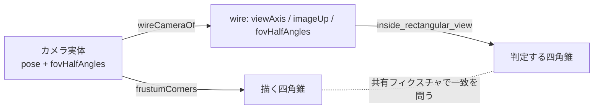

# 171. 描かれた視野が判定される視野である — カメラの視野は矩形で宣言し、矩形で判定する

- Status: Accepted (実装済み 2026-11-10 — 方向と Q2 の読み「半角 2 つと上方向を任意で足し、無ければ今の円錐」は当事者の合意 (同日の俯瞰 Q1/Q2「推奨で良い」)。フロントの旧形式カメラを正方形として送る読みは Claude が選んだもので、当事者が異なる読みを選べば改訂する)
- Date: 2026-11-10
- Deciders: yuubae215 (要求: 2026-10-11「後でソルバーも見直しましょう」/ 2026-11-10「決めずに残したものから、導入価値の高いものから」), Claude (起票・実装)
- 状態台帳: ビジョンカメラの行を更新 (視野の形 — 円錐 / 矩形はワイヤの状態、フロントの宣言は矩形だけ)
- 段: なし
- Retires: GREP:src/domain/visionCamera.js::inscribed\scone
- Supersedes / Superseded by: ADR-164 D3 の暫定 (「描くのは内接円錐がソルバの円錐に一致する正方形」) を置き換える。DEF-061 を閉じる

## Context — Goal と力学

ADR-164 D3 でカメラはシーンの実体になり、3D に**矩形**の視錐台を描く (当事者判断 2026-10-11)。
しかしワイヤの `camera` が言えるのは半角 1 つ (`fovHalfAngle`) で、`core/` は視軸まわりの
**円錐**で判定していた。暫定として、内接円錐がソルバの円錐に一致する正方形を描き、パネルに
「四隅は描かれているが判定されていない」と断り書きを出していた (DEF-061)。

断り書きは嘘ではないが、**絵と判定が違うことを人に覚えさせている**。四隅に置いたワークは
「視錐台の中に見えるのに、見えないと言われる」。原則 #33 (4) — 語が実物のどこを指すかを
走らせる前に確かめる — は絵が判定と一致して初めて成り立つ。

**Goal:** 画面に描かれた視錐台の内側と、判定エンジンが「視野の内」とする範囲が一致する。
既存のワイヤ利用者 (半角 1 つのテンプレ) の答えは 1 つも動かない。

**語彙 (原則 #33):** 「横 30°・縦 20° まで見える」は半角 1 つでは言えない — 1 語が 2 つの事実を
兼ねていた。さらに矩形は視軸まわりの**向き** (ロール) を持つので、「画像の上はどちらか」という
3 つ目の事実が要る。円錐は回転対称なのでこの事実を必要としなかった。

## Options considered

- **A (採用): 矩形を任意で足す。** `fovHalfAngles: {horizontal, vertical}` + `imageUp`。無ければ
  従来の円錐。— tradeoff: ワイヤの視野の形が 2 つになる (両立は拒否する — D2)。
- **B: 半角 1 つを廃して矩形だけにする。** — tradeoff: 既存の全リクエストが壊れる。円錐で
  判定したい利用者 (回転対称のセンサ) の言い方が消える。当事者が Q2 で退けた。
- **C: 円錐のまま、描く形を円錐にする。** — tradeoff: 当事者判断 (2026-10-11「矩形」) に反する。
  実カメラの像は矩形である。
- **D: 現状維持 (断り書き)。** — tradeoff: 上記の力学がそのまま残る。

## Decision

- **D1 — ワイヤ (request 契約、任意の追加 — 版上げなし)。** `camera.fovHalfAngles:
  {horizontal, vertical}` (rad、各 (0, π/2)) と `camera.imageUp: [x, y, z]` (ワールド、単位長で
  なくてよい)。request 側の任意追加は contractVersion を上げない (ADR-083/084 の先例)。`camera` は
  閉じたオブジェクトなのでスキーマ更新は要る。
- **D2 — 視野の形は 1 つ。倒さない。** `fovHalfAngle` と `fovHalfAngles` の同時宣言、矩形で
  `viewAxis` か `imageUp` が欠ける、`imageUp` が視軸と平行、半角が範囲外 — いずれも
  `DeclarationError` (400)。円錐や「視野なし」へ黙って倒すと、どの形で判定されたかが応答から
  読めない (原則 #31)。スキーマも `not` / `dependentRequired` で同じことを言う。
- **D3 — 判定 (閉形式)。** 前 f = 視軸、上 u = imageUp から f 成分を除いて正規化、右 r = f × u
  (ROS optical frame と同じ手系)。視線 d = 点 − 光学中心 について

  ```
  z = d·f > 0   かつ   |d·r| ≤ z·tan(horizontal)   かつ   |d·u| ≤ z·tan(vertical)
  ```

  境界は内側。奥行きは無制限 (円錐と同じ)。視野の外は遮蔽量で測れないので `inf` (従来どおり
  `occlusionNearestMiss` に入れない)。遮蔽の判定は形に依らず同じ。
- **D4 — フロントの宣言は矩形だけ。** カメラの宣言は `camera.fovHalfAngles` (3 つの公開スキーマに
  版内の追加)。ADR-171 より前の `fovHalfAngle: a` は**正方形 `{a, a}` として読む** — その
  カメラにずっと描かれてきた正方形そのもので、絵は変わらず、判定が絵に追いつく。書き手
  (`withFieldOfView`) は常に 2 角の形で書き、旧い鍵を落とす。両方が在る宣言は malformed。
  フロントは円錐をワイヤに**送らない** — 円錐はワイヤ利用者のための形として残る。
- **D5 — `imageUp` は導出。** `viewAxis` と同じく、フレームのワールド回転 · 光学 −Y から毎回
  計算する (保存しない — 回した瞬間に古くなる写しを作らない、§1.1)。
- **D6 — 「今の視点を写す」は視点の矩形を写す。** 垂直 = THREE の fov の半分、水平 =
  atan(aspect · tan(垂直))。aspect が読めなければ視野は写さない (正方形を推測しない)。
- **D7 — 描く形と判定する形の一致を機械が問う (ADR-146 D3)。** 源は `core/` (判定する側)。
  共有フィクスチャ `fixtures/cross-language/camera-rectangular-view.json` を
  `core/tests/test_engine.py` (稜線のすぐ内は見え、すぐ外は見えない) と
  `src/robotics/CrossLanguageDerivation.test.js` (`wireCameraOf` の向きと `frustumCorners` の四隅が
  同じ稜線に乗る) の両方が読む。



## Consequences

- 断り書きと `frustumCorners` の「内接円錐」の説明は消えた (`Retires:`)。DEF-061 の行を削除。
- **フロントで既にカメラを置いていた文書は答えが動きうる** — 四隅に在る点が「見える」になる
  (狭まる方向には動かない: 内接円錐 ⊂ 正方形)。これは直したかった差そのもの。ワイヤを直接
  叩く利用者 (テンプレ・`pick-sequence`) は半角 1 つのままなら 1 つも動かない
  (`pnpm test:core` のテンプレ検査が緑のまま)。
- スタブ (`mocks/graspStub`) も同じ閉形式で矩形を判定する (生産者が 2 つ在るので両方)。
- **見ないもの:** レンズ歪み・被写界深度・近遠クリップ。矩形は理想ピンホール。自己遮蔽は
  従来どおり見ない (ADR-081)。
- 同義語辞書 (`QUOTIENT_TABLE`) には行を足していない — 辞書は話し手が文で使う語 (5W1H・場所・
  配置) の表で、把持の宣言の欄名 (`hand` / `camera`) は載っていない。語 → 確かめる絵の表
  (`CONFIRMATION_BY_FIELD`) には `camera.fovHalfAngles` を足した。

## 検証 (証拠)

goal ごとの支えの正本は `docs/gsn/adr-171-the-field-of-view-drawn-is-the-field-of-view-judged.gsn`。
入口だけ: `pnpm test:core` (`test_engine.py` の ADR-171 節) / `pnpm test`
(`visionCamera.test.js`・`CrossLanguageDerivation.test.js`・`GraspController.test.js`) /
`pnpm test:stub` / `pnpm test:contract`。
