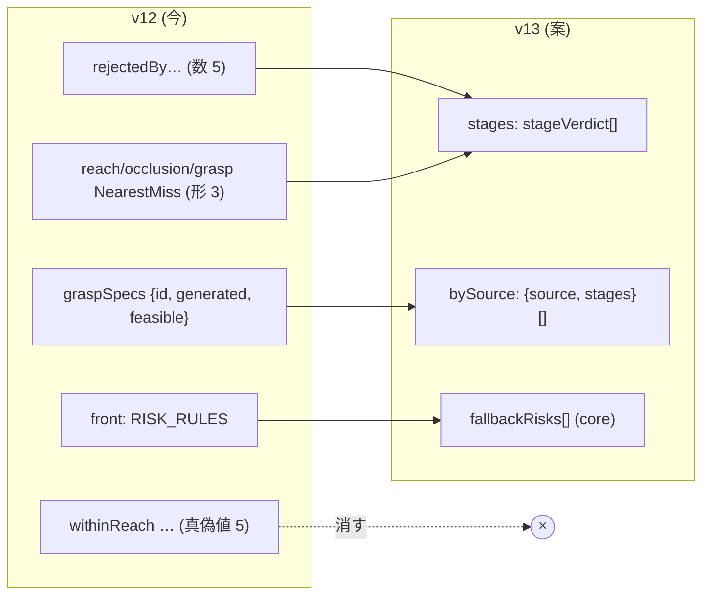

# 172. 応答は 1 つの事実を 1 つの語彙で言う — 段・相・障害物の当たり・「問うていない」を共有の型にし、フォールバックのリスクはエンジンが決める

- Status: Proposed (2026-11-12 起票。方向は当事者合意 — 2026-11-11〜12 の棚卸しへの返事: 範囲は把持探索の応答 1 本 (request 側は残し)、返す候補の 5 つの真偽値は消す、ADR を Proposed で起こしてから俯瞰で合意する。D1〜D8 の読み方は俯瞰で当事者が決める)
- Date: 2026-11-12
- Deciders: yuubae215 (要求: 「Q4 は現在の型の意味の棚卸しと必要ならリファクタリングを前提に調査してからやりたい」→「全体の型を俎上に上げてからじゃなくていい?」→「(リスク表は) 移しても良いよ エンジンに移して繋ぎ直す?」→「b までやってほしいけど、それは残しにして、a まで」), Claude (起票)
- 状態台帳: `docs/STATE_LEDGER.md` に行を足した (段の判定 — 案)。既存の「候補ごとの objective 評価」「相ごとの干渉判定」の行と同じ『判定した / 問うていない』の形を段に広げる
- 段: なし
- Retires: GREP:packages/grasp-contract/schema/grasp-search-response.schema.json::rejectedByReach · GREP:src/view/GraspLadderMath.js::RISK_RULES · GREP:packages/grasp-contract/schema/grasp-search-response.schema.json::withinReach
- Supersedes / Superseded by: なし。ADR-081 の §3 (ドメイン KPI とフォールバック階梯をフロントに置く) と ADR-152 D4 (仕様の行は生成数と通過数だけ) を部分的に置き換える。DEF-048 を受ける

## Context — Goal と力学

把持探索の応答 (`grasp-search-response`, 契約 v12) の型 24 個を並べると、欠陥は
「1 つの事実の言い方が型ごとにばらばら」という 1 つの形にまとまる。

1. **「段」に型が無い。** 同じ 5 段 (リーチ・IK・把持性・可視性・干渉) が、返す候補では真偽値
   (`withinReach` …)、診断では数 (`rejectedByReach` …)、最も惜しい差では 3 つだけ (形もそれぞれ違う)、
   フロントでは 3 ドメインに束ねられる。1 つの事実に名前が 3〜4 個ある (原則 #33 の逆向き)。
2. **「問うていない」の言い方が 5 通りある。** `kind: undeclared` (関節解・腕・再生の腕) /
   `kind: unevaluated {reason}` (相) / 鍵の不在 (objective — ADR-120) は区別できる。
   **空虚な `true` (見える・掴める) と `0` (段の棄却数) は区別できない** — 2026-11-11 に直した
   「カメラが無いのに seen 100%」はここから来ていた (ADR-081 追記)。
3. **障害物の当たりを数える型が 4 つ** (`{part, obstacleIndex, candidates}` / `{obstacleIndex, candidates}`
   / `{part, obstacleIndex}` / `obstacles: [int]`)。部位の列挙も型ごとに違う。
4. **排他かどうかが型ではなく説明文にしか無い。** 段の棄却数・相の帰属は排他 (足すと全体)、分析の
   `collided`・腕の測定・棄却の組は排他でない。さらに仕様の行には**導出の行が無い**ので、仕様が全滅して
   導出へ戻った探索では「生成 40 / 仕様の行の和 4」になり、残り 36 件はどの行にも入らない (実測
   2026-11-11)。段別の数 (DEF-048) を今の型に足すと、この 36 件の棄却がどこにも数えられない。
5. **相の列挙が 4 か所以上に、関節の配列が 3 か所に書き写されている** (「ちょうど 6」の制約の有無も違う)。

加えて、**フォールバック階梯のリスク表** (`GraspLadderMath.RISK_RULES` — どの数ならどの手戻りの段か) は
キュレーションされた判断知 = 置き場所の 3 軸の 1 番目 (アイデア) に当たる。ADR-081 が表示として front に
置いたのは、ADR-146 がこの軸を立てる前だった。

**Goal:** 応答の利用者は、1 つの事実を 1 つの名前で読み、「判定した結果が 0」と「問うていない」を型で
見分け、足してよい数と足してはいけない数を型で見分けられる。仕様ごとの段別の内訳は、候補全体を漏れなく
分ける行の上に載る。どの手戻りが要りそうかはエンジンが決め、フロントは表示する。

## Options considered

- **A (採用案): 応答 1 本を共有の型で作り直す (契約 v13)。** 下の D1〜D8。
  — tradeoff: フロントの消費者 (漏斗・ラダー・パネル・メーター・ゴースト) とスタブ・BFF の型・core の
  導出が全部動く。版上げは 1 回で済む。
- **B: 今の型に最小限を足す** (仕様の行に段別の 5 つの数と導出の行だけ)。
  — tradeoff: 2・3・5 の欠陥が残り、「0 と問うていない」は次の欄でもまた起きる。
- **C: request 側の語 (段・相・障害物) まで揃える。**
  — tradeoff: 利用者の書くファイル (テンプレ・文書) まで動く。当事者は望んでいるが、**残しとして
  分ける** (DEF-082) — request は open payload で統治の規則が違うので、別の回にするほうが安い。

## Decision (案 — 読み方は俯瞰で当事者が決める)

- **D1 — 共有の語。** `stage` (列挙: reach / ik / grasp / visibility / interference) と `phase`
  (列挙: 6 相) を `$defs` に 1 つずつ置き、すべての欄がそれを参照する。
- **D2 — 段の判定は閉じた kind。** `stageVerdict = {stage, kind: 'judged', entered, rejected, nearestMiss}
  | {stage, kind: 'notAsked', reason}`。`entered` (その段に入った数) をワイヤに載せる — 段の並びから
  利用者が導くと、並びを変えた日 (DEF-038) に黙って間違う。`reason` は閉じた列挙
  (`cameraUndeclared` / `gripperUndeclared`)。
- **D3 — 最も惜しい差も閉じた kind。** `{kind: 'measured', quantity, value}` (quantity は閉じた列挙:
  reachDistance / occlusionDepth / openingShortfall / sealPatchShortfall) / `{kind: 'unmeasurable', reason}`
  (棄却はあるが量で測れない — 視野の外・パームが潜る) / `{kind: 'noRejection'}` /
  `{kind: 'noQuantity'}` (この段は差の量を持たない — IK・干渉)。null が 2 つの事実を兼ねる形を消す。
- **D4 — 診断は段の列と、候補の出どころの行。** `diagnostics = {candidatesGenerated, feasible, returned,
  stages: stageVerdict[5], bySource: [{source: {kind: 'spec', id} | {kind: 'derived'}, candidatesGenerated,
  feasible, stages}], interferencePhases, interferenceAnalysis, fallbackRisks}`。**行の和 = 全体**
  (生成・通過・段ごとの棄却) をスキーマの説明と両側の準拠テストで縛る。宣言した仕様はすべて行を持ち、
  導出の行は導出の候補を生成したときだけ在る。**DEF-048 (仕様ごとの段別の内訳) はここで閉じる。**
- **D5 — 返す候補の 5 つの真偽値を消す** (当事者合意)。返す候補は 5 段すべてを通っているので常に
  true で、見える・掴めるは問うていなくても true だった。ゴーストの線の種類 (`ghostLineStyle`) は
  この 3 つを読んでいたが、返す候補は常に実線になるので読む必要が無くなる。
- **D6 — 障害物の当たりは 1 つの型。** `obstacleTally = {part, obstacleIndex, candidates}` (part は
  tcpPath / arm / hand / held の閉じた列挙)。腕の測定もこの型を使う (`part: 'arm'`)。再生の 1 標本の
  当たりは数を持たないので `obstacleHit = {part, obstacleIndex}`。
- **D7 — 排他かどうかは欄の名前で言う。** 足すと全体になる数は `rejected` (帰属)、足してはいけない数は
  `touched` (当たった)。`interferenceAnalysis.phases[].collided` → `touched`、棄却の組の `rejected` →
  `touched` (1 候補が複数の組に数えられるため)。
- **D8 — フォールバックのリスクはエンジンが決める** (当事者合意 2026-11-11)。
  `fallbackRisks: [{domain: 'vision' | 'path' | 'grasp' | 'all', level: 3..6, reason}]`。`reason` は
  閉じた列挙で、文言はフロントが列挙から引く (表示)。階梯の段の名前と費用の目安 (`LADDER`) は表示として
  フロントに残す。問うていない段からリスクは出さない。
- **関節の配列**は `jointVector6` を 1 つ置き、`reachSolution` と再生の腕が参照する
  (`poseJointSpace` は機種を限らないので対象外)。

## Consequences

- 契約 v13。消費者は全部書き換える: `GraspFunnelMath` / `GraspLadderMath` (KPI は `stages` から読むだけに
  なり、`RISK_RULES` は消える) / パネル / メーター / `GraspGhostMath` / スタブ / BFF の型 / core の
  導出と準拠テスト / examples。
- **request 側は触らない** — 段・相・障害物の語を request に揃えるのは DEF-082。
- 2026-11-11 にフロントで直した率の分母 (ADR-081 追記) は、`entered` がワイヤに載るので導出が要らなくなる。

## 検証 (証拠 — 予定)

goal ごとの支えの正本は `docs/gsn/adr-172-a-response-says-each-fact-in-one-vocabulary.gsn`。予定:
core の準拠テスト (`bySource` の和 = 全体、仕様が全滅して導出へ戻ったとき導出の行が在る、`notAsked` の段は
`entered` を持たない) / 契約パッケージのテスト (`unmeasurable` と `noRejection` の区別、`touched` と
`rejected` の欄名) / フロントの単体テスト (問うていない段に率もリスクも出ない) / e2e。

## Lens notes

- 状態機械は起こさない — 段の判定は応答 1 回ごとの事実で、遷移を持たない。台帳には基数 (段 5 つ・
  出どころの行 `0..N` 仕様 + `0..1` 導出) を書く。
