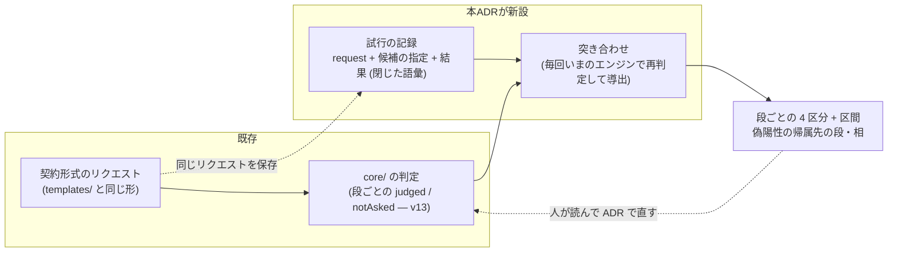

# 173. 判定は予測であり、実機の試行で採点される — 試行は判定の写しと結果の閉じた語彙で記録し、突き合わせは毎回いまのエンジンで導出する

- Status: Proposed
- Date: 2026-11-21
- Deciders: yuubae215 (要求: 「掴めるか、ってどうやって検証可能？」→ 回答の §3「判定を予測として扱い、実機の結果と突き合わせる」に対し「実機との突き合わせの仕組みを ADR に起票して」), Claude (起票)
- 状態台帳: 実装の段で `docs/STATE_LEDGER.md` に「試行の結果」の行を足す (結果の語彙 = 閉じた列挙、基数 = 1 候補あたり 0·1·N 回、**棄却候補の試行 0 回は宣言させる** — D4)。本 ADR は起票のみでコードを持たないので、この commit では足さない
- 段: **G-10** (`docs/grasp/implementation-order.md`)。前提: なし (ADR-172 の契約 v13 — 段ごとの判定 `judged` / `notAsked` — の上に載る)
- Retires: なし — 既存の何も置き換えない。`docs/dogfooding/` の自由記述の記録は「既定値を獲得する」別の問いのためのもので、本 ADR はその隣に**突き合わせられる**記録を新設する
- Supersedes / Superseded by: なし。ADR-122 の `WhyProbabilityStaysOutOfTheSolver` (歩留まりは物理シミュレーションでソルバに戻さず、実験計画 + 統計的計測で置く) に置き場所と形を与える。ADR-081 の `ConvergenceBySweetSpot` (実データ較正で領域を獲得する) の「実データ」がここに溜まる

## Context — Goal と力学

### 出所

当事者の問い「掴めるか、ってどうやって検証可能？」に対する棚卸しで、次がはっきりした。

- `core/` の「掴める」は**幾何的な必要条件**の判定である。開口と閉じ方向の厚み
  (ADR-152)、深さのゲート、指と周囲の干渉 (ADR-157 の相)、吸着の密着、吸着の保持
  `u < 1` (ADR-156) のどれも `pnpm test:core` が式どおりであることを問う。
- しかし「実物が落ちずに持ち上がるか」は**どこでも問われていない**。平行ジョーの
  wrench cone は `docs/gsn/adr-081-grasp-validation.gsn` で「証拠予定」のまま、
  吸着の保持は剛体カップ・静荷重の近似 (ADR-156 D8)。
- 事業木 `docs/gsn/profit-growth.gsn` の項 **q (判定が現実と一致する率)** の goal
  `VerdictIsTrustworthy` の下には、絵と判定のずれ・量のずれ・判定の代理を除く木が
  吊られているが、**q そのものを測る木は 1 本も無い**。ずれの種類を潰していくことは
  q を上げる手段であって、q が上がったことの証拠ではない。

### Goal (性質)

> **判定と現実の食い違いが数えられ、その食い違いが「どの段の・どの近似を見直すべきか」へ
> 帰属できる。しかも、エンジンを直したあとの食い違いが、記録を取り直さずに数え直せる。**

解の形 (「混同行列を作る」) ではなく、この性質を Goal に置く。混同行列は数える手段の 1 つで、
帰属と数え直しが無ければ数字が出ても次の一手が決まらない。

### 力学

1. **実機の結果は判定を待たずに固定される事実、判定はエンジンの版とともに動く導出値。**
   記録に「判定は取れる、結果は失敗 → 偽陽性」と書き込むと、エンジンを直した日に
   その行は嘘になる (判定はもう取れないと言うかもしれない)。導出値を記録に焼くのは
   原則 #24 の閉路で、しかも §1.1 の第二の源である。
2. **試さなかった棄却候補は行を持たない (原則 #31)。** 人は「取れる」と言われた候補しか
   実機で試さない。すると偽陰性 (判定は取れない、実際は取れる) は**測られないまま 0 に
   見える**。判定が厳しすぎることは、この盲点の中では永遠に分からない。
3. **失敗の言い方が自由記述だと帰属できない。** 「なんか滑った」「ちょっと当たった」は
   突き合わせられない。ADR-081 / dogfooding README が様式を固定したのと同じ理由。
4. **試行は少ない。** 実機の 1 回は高い。3 回中 3 回成功を「100%」と読むと、q を
   過大に主張する (原則 #29 の逆 — 決定していない事実を決定したように言う)。
5. **実機の試行はアプリの外で起きる。** このアプリはロボットを動かさない
   (動かす経路も作らない)。記録は人が持ち込むデータである。

### 位置づけ



点線の最後の辺は**人の判断**である。突き合わせの結果を自動でソルバの入力に戻さない (D5)。

## Options considered

- **A: 現状維持 — `docs/dogfooding/` の自由記述に実機の所感を書く。**
  tradeoff: 追加の仕組みは要らない。しかし力学 1〜3 のすべてに当たる: 判定が焼かれ、
  棄却候補は試されず、失敗は帰属できない。突き合わせは書いた人の頭の中にしか無い。
- **B: 物理シミュレーション (把持の動力学) を実機の代わりに使う。**
  tradeoff: 回数を安く稼げる。しかし ADR-122 が却下した形そのもの — シミュレータの
  摩擦・接触モデルは実物の代理で、代理で代理 (`core/` の判定) を採点しても q は測れない。
  シミュレータを使うなら、それ自体も本 ADR の記録で実機と突き合わせる対象になる。
- **C: 試行の結果をアプリで入力し、ワイヤに載せてコアAPI に送る。**
  tradeoff: 当事者が画面から記録できる。しかし契約が増える (原則 #29 — ワイヤは
  ソルバが決定した事実のみ。試行の結果はソルバの決定ではない)。突き合わせの形が
  固まる前に契約にすると、語彙を直すたびに版を上げることになる。後段の候補として残す。
- **D (採用): 試行は repo 内のデータとして記録し、突き合わせはエンジンを再実行して導出する。**
  tradeoff: 記録はファイルを書く手間がある (画面は無い)。そのかわり記録の形は
  リクエストの写しと閉じた語彙だけで、エンジンが変わっても記録は変わらない。

## Decision — Strategy

**D を採る。** 判定を予測として扱い、試行で採点する。そのために 6 つを決める。

### D1. 試行の記録は「判定の写し」ではなく「判定を再現できる入力」を持つ

1 件の記録 (= 1 つの配置で 1 つ以上の候補を試した単位) は次を持つ:

| 欄 | 中身 | なぜ |
|---|---|---|
| `request` | grasp-search の契約形式リクエストそのもの (`templates/*/grasp-search.request.json` と同じ形) | いまのエンジンで再判定できるように |
| `recordedWith` | 記録時の `contractVersion` とエンジンの commit | 再判定の答えが変わったときに「何が変わったか」を辿るため (突き合わせには使わない) |
| `trials[]` | 試した候補の指定 (候補の姿勢 — v13 の pose union の形) と、各回の結果 (D2) | 結果は試行の事実 |
| `sampling` | 棄却候補をどう選んだか、または**選ばなかったことの宣言** (D4) | 偽陰性を測ったかどうかの区別 |

記録に**判定そのもの (取れる / 取れない、スコア) を書かない。** 書けば力学 1 の閉路になる。
`recordedWith` は来歴であって判定の源ではない。

### D2. 結果は閉じた語彙で言い、語ごとに帰属先の段・相を持つ

初版の語彙 (閉じた列挙 — 足すのは本 ADR の改訂か後続 ADR):

| 結果 | 意味 | 偽陽性だったときの帰属先 |
|---|---|---|
| `held` | 持ち上げて搬送し、置けた | — (成功) |
| `missed` | 掴む前に位置がずれて掴めなかった (爪が対象に届かない・吸着が当たらない) | リーチ / IK (姿勢の精度) |
| `collided` | 動作のどこかで周囲に当たった | 干渉 — **どの相か** (ADR-157 の 6 相のどれか) を必須で添える |
| `slipped` | 閉じた・吸った後、持ち上げで滑り落ちた | 把持性 (平行ジョーなら摩擦 — 未判定、吸着なら `suction_hold`) |
| `peeled` | 吸着カップがめくれて外れた | 把持性 (`suction_hold` の `u_peel`) |
| `dropped` | 搬送中に落ちた | 把持性 (搬送加速度 — ADR-156 D8 で数えていない) |
| `notAttempted` | 試さなかった。**理由を必須** (安全上止めた / 時間切れ ほか) | 帰属しない (分母から外す) |

帰属先が「いま判定していないもの」(平行ジョーの摩擦、搬送加速度) を指すことは
**そのまま数える**。そこに偽陽性が溜まること自体が、wrench cone や搬送の判定を
足す根拠になる (ADR-081 の「証拠予定」を満期へ動かす事実)。

### D3. 突き合わせは保存せず、毎回いまのエンジンで導出する

突き合わせは記録の `request` を**いまの `core/` に投げ直し**、試した各候補について
判定を得てから数える。数えるものは段 s ごとの 4 区分と全体:

```
判定 \ 結果        成功 (held)    失敗 (held 以外、notAttempted を除く)
取れる (全段通過)       TP              FP   ← 帰属先の段・相ごとに内訳
取れない (段 s で棄却)  FN_s            TN_s

q̂        = (TP + Σ TN_s) / n                      n = notAttempted を除く試行数
precision = TP / (TP + FP)                          「取れる」と言ったときの当たり率
```

試行は少ないので、率は**点ではなく区間で**出す (力学 4)。二項比率の Wilson 区間
(公知の閉形式 — 95%, z = 1.96):

```
p̂ = k / n,   中心 = (p̂ + z²/2n) / (1 + z²/n),
半幅 = z · √( p̂(1−p̂)/n + z²/4n² ) / (1 + z²/n)
```

3 回中 3 回成功は「100%」ではなく「[0.44, 1.00]」と言う。区間の下端が判断の材料になる。

エンジンが変わって判定が変わった試行は、**前回との差として列挙する** (「この試行は
前回 FP、いまは TN」)。それが「直したら現実に近づいたか」の唯一の証拠になる。

### D4. 棄却候補の試行は「した」か「しないことを宣言した」かのどちらか

各記録の `sampling` は次の 2 状態だけを持つ (原則 #31 — 0 を推論させず宣言させる):

- `rejectedSampled`: 棄却された候補から何件を・どう選んで試したか (段ごとに)
- `rejectedNotSampled`: 棄却候補を試していない。**理由を必須**

突き合わせの出力は、FN を測っていない段を **「測っていない」と言う** (0 件と言わない)。
ADR-120 / ADR-172 の `notAsked` と同じ形 — 評価していないことは 0 点ではない。

### D5. 突き合わせの結果はソルバに戻さない

突き合わせは人が読むための数字である。判定の重み・しきい値・近似を変えるのは、
その数字を根拠にした **ADR (または既存 ADR の改訂)** であって、記録から自動で
較正しない。理由は ADR-122 `WhyProbabilityStaysOutOfTheSolver` と同じ (原則 #24 の閉路)、
加えて「アイデア (重み・しきい値) は core/ にあり、人が決める」(CLAUDE.md §AI 向けガード
軸 1) — 自動較正はアイデアを記録件数の偶然に決めさせる。

### D6. 置き場所 — 記録はデータ、突き合わせは core/ の検査の隣

- 記録の形 (JSON Schema): `core/` の検査データとして置く。契約 (`packages/grasp-contract`)
  には入れない — BFF ⇄ コアAPI のワイヤではないから (原則 #29)。
- 突き合わせ: `core/` の Python (エンジンを直接呼ぶ — HTTP を経由しない)。重い計算でも
  アイデアでもないが、**判定を呼ぶ**ので `core/` 以外に置けない (src/ から core/ を
  呼ぶ経路は無い)。
- 記録そのもの: 記録の置き場所は**当事者が決める** (未決 — 下の §決めてほしいこと Q1)。

### 決めてほしいこと (起票時点で未決 — 段 G-10 の俯瞰で合意する)

**2026-11-23 当事者: 「Q2 以外推奨で良い」。** Q1 = スキーマと突き合わせは repo、記録は repo 内
でも repo 外 (環境変数で指す) でも読む。repo 内に公開できる見本の記録を 1 件以上置く。Q3 = D4 のとおり
「試さないなら理由つきで宣言」まで (段ごとの最低件数は求めない)。Q4 = 単位は試行 (D3 の式のまま)。
Q2 は「`missed` と `collided` は論理で切り分けられるか」と問い返された — 未決。

- **Q1. 記録を repo に置くか。** 実機の対象 (顧客の部品の寸法・質量) は公開できない
  ことがある。案: スキーマと突き合わせは repo、記録は repo 内のディレクトリ **または**
  環境変数で指す repo 外のディレクトリのどちらでも読む。repo 内には公開できる
  見本の記録 (手書きテンプレの配置) を 1 件以上置き、突き合わせの検査が 0 件で
  緑にならないようにする。
- **Q2. 結果の語彙 (D2) の初版はこれでよいか。** 特に `missed` と `collided` の
  境目 (爪が対象の上面に当たって掴めない = どちらか)。
- **Q3. 棄却候補をどれだけ試すことを求めるか。** D4 は「試さないなら宣言」までしか
  求めない。段ごとに最低 1 件を求めるかは、実機 1 回のコストを知っている当事者が決める。
- **Q4. 1 候補を k 回試したとき、単位は「試行」か「候補」か。** 本 ADR の式は試行を
  単位にした (同じ候補の 10 回は 10 件)。候補を単位にする (成功率がしきい値以上なら成功)
  なら、そのしきい値はアイデアなので core/ 側の宣言になる。

## Consequences — Evidence と tradeoff

- 肯定的:
  - q に初めて**測った値**が付く (区間つき)。事業木の `VerdictIsTrustworthy` が
    「ずれを潰した」だけでなく「一致した率」で支えられる。
  - 偽陽性が段・相へ帰属するので、次に直す近似が数字で選べる。いま判定していない
    もの (平行ジョーの摩擦・搬送加速度) に溜まる偽陽性が、それを判定に足す根拠になる。
  - エンジンを直したとき、**同じ試行で**前と後を比べられる (記録を取り直さない)。
- 受け入れるコスト / 否定的:
  - 記録は手で書く。画面は無い (C は後段)。
  - 実機の試行そのものはこのリポジトリの外で起き、その安全はこの仕組みが保証しない。
  - 試行数が少ないあいだ、区間は広く、ほとんど何も言えない。それを隠さないのが D3 の目的。
  - 再判定はエンジンが記録の `request` を読めることを前提にする。契約の版上げで古い
    リクエストが 400 になったら、その記録は**数えられない記録**として出す (黙って捨てない
    — 原則 #11)。
- 検証(証拠): goal ごとの支えの正本は **`docs/gsn/adr-173-a-verdict-is-a-prediction-scored-against-real-trials.gsn`**。
  起票時点ではすべて `support-exploring` で、決着させる検査を満期つきで名指ししてある。
- 波及(blast radius): `core/` (記録のスキーマ + 突き合わせ + 検査)、`docs/STATE_LEDGER.md`
  (試行の結果の行)、`docs/dogfooding/README.md` (突き合わせ用の記録はこちら、と名指しする 1 行)、
  事業木 `profit-growth.gsn` (q の goal に木を吊る)。フロント (`src/`)・BFF・契約は**触らない**。

## Lens notes

- **様態:** 試行は事象駆動 (CMMN) — いつ・どの配置で試すかは現場の裁量で、記録は事後に
  持ち込まれる。突き合わせは決め打ちの逐次 (BPMN — 読む → 再判定 → 数える)。
- **状態:** 試行の結果は 7 値の閉じた列挙で、遷移を持たない (記録したら変わらない)。
  状態機械は要らないが、基数 (1 候補あたり 0·1·N 回、棄却候補の試行 0 回) は台帳に載せる。
- **真実の源:** 結果の源は記録、判定の源はエンジン。突き合わせはどちらにも書き戻さない導出。
